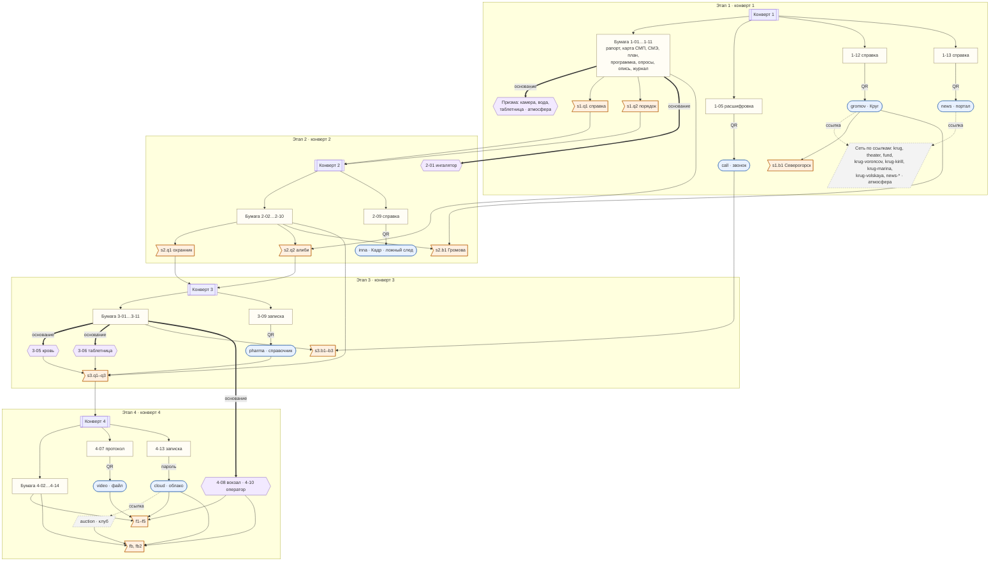

# Карта улик: бумага, сайты, экспертизы

Черновик сценариста, 21.10.2026. Шаг 1: карта «как сейчас» и предложение. Контент (`content/`) этим документом **не меняется**: всё, что в разделе «Предложение», вносится на шаге 2 после решения автора.

Источники: `docs/SCENARIO.md` (раздел «Синхронизация» главнее), `docs/STORY-BIBLE.md`, `docs/STORY-CHANGES.md` (запись 21.10), `docs/REDESIGN-2026-10.md`, `docs/VOICES.md`, `content/stages.yaml`, `content/documents.yaml`, `content/expertise.yaml`, `content/pages/*`, `content/paper/*`, `content/documents/*`, `content/chats/*`.

Промпты для фото, аватарок и голосовых — `docs/drafts/pages/PHOTOS-2.md`.

## Оглавление

1. [Условные обозначения](#1-условные-обозначения)
2. [Как сейчас](#2-как-сейчас)
   - 2.1 Навигация: как попасть на каждую страницу
   - 2.2 Этап 1 · 2.3 Этап 2 · 2.4 Этап 3 · 2.5 Этап 4 — откуда берутся ответы
   - 2.6 Экспертизы «Призмы»
   - 2.7 Какие страницы несут улики, а какие только атмосферу
   - 2.8 Что нашлось при сверке
   - 2.9 Схемы
3. [Предложение](#3-предложение)
   - 3.0 Ограничения: что нельзя писать на открытых страницах
   - 3.1–3.10 Предложения по ценности
   - 3.11 Новые бонусы и баллы
   - 3.12 Схема после предложений
   - 3.13 Новые сюжетные детали (для журнала)
4. [Фото, голосовые, «жизнь» в соцсетях](#4-фото-голосовые-жизнь-в-соцсетях)
5. [Вопросы автору](#5-вопросы-автору)

---

## 1. Условные обозначения

| Обозначение | Что значит |
|---|---|
| **бумага 1-08** | документ конверта (`content/paper/`), на руках у игроков с начала этапа |
| **QR → `gromov`** | страница открывается по QR-коду (или напечатанному адресу) с бумажного документа |
| **ссылка → `theater`** | страница открывается только переходом с другой страницы |
| **«Призма»: объект + основание → 3-05** | заключение выдаёт лаборатория, если введён объект из описи и выбрано основание |
| открытая | `locked: false`, видна с этапа 1 любому, кто знает адрес |
| закрытая (этап N) | ключ в QR-коде конверта N или в ссылке с закрытой страницы того же этапа |
| спящая улика | видна с этапа 1, смысл понятен только с документами поздних этапов |

На схемах: `[[Конверт]]`; прямоугольник — бумага; овал — страница по QR; параллелограмм — страница только по ссылке; шестиугольник — экспертиза; флажок — вопрос. Рёбра: `QR`, `ссылка`, `пароль`, `основание` (толстая стрелка) и сплошная стрелка без подписи — «нужно для вопроса».

---

## 2. Как сейчас

### 2.1. Навигация: как попасть на каждую страницу

| Страница | Этап, доступ | Как попасть | Куда ведёт |
|---|---|---|---|
| `call` — запись звонка | 1, открытая | QR на 1-05 | — |
| `gromov` — Громова в «Круге» | 1, открытая | QR на 1-12 | `theater` (пост 08.11), `krug-voroncov` (пост 11.11), `krug` (логотип), `krug-private` (комментаторы) |
| `news` — статья портала | 1, открытая | QR на 1-13 | `theater`, `krug-voroncov` (статья), `news-yama`, `news-library`, `news-hockey` (боковая колонка) |
| `news-yama`, `news-library`, `news-hockey` | 1, открытые | ссылка из боковой колонки `news` и друг друга | `news`, друг друга |
| `krug` — главная «Круга» | 1, открытая | логотип на всех страницах «Круга», партнёры `theater` | «Популярное»: `krug-voroncov`, `theater`, `gromov`, `krug-kirill`, `krug-volskaya`, `news-yama`; поиск по открытым профилям |
| `krug-voroncov` | 1, открытая | `news`, `theater`, `gromov`, `krug`, друзья и комментарии других профилей | `krug-kirill`, `krug-marina`, `krug-volskaya`, `theater` |
| `krug-kirill` | 1, открытая | `krug`, `krug-voroncov`, `krug-marina` | `krug-voroncov`, `krug-marina` |
| `krug-marina` | 1, открытая | `krug-voroncov`, `krug-kirill` | `krug-kirill`, `krug-voroncov` |
| `krug-volskaya` | 1, открытая | `theater` («Друзья театра»), `krug`, `krug-voroncov` | `krug-voroncov`, `theater` |
| `krug-private` — заглушка | 1, открытая | любой автор без страницы | `krug` |
| `theater` — сайт ВОДТ | 1, открытая | `news`, `gromov`, `krug-voroncov`, `krug-volskaya`, `fund`, `krug` | `krug-voroncov`, `fund`, `krug-volskaya`, `news`, `krug` |
| `fund` — фонд «Сцена» | 1, открытая | `theater` (партнёры, карточка худрука) | `theater` |
| `inna` — Инна в «Кадре» | 2, закрытая | QR на 2-09 | — |
| `pharma` — справочник | 3, закрытая | QR на 3-09 | — |
| `cloud` — облако погибшего | 4, пароль | QR на 4-13 + логин и пароль из 4-13 | `auction` (письмо «Если вы это читаете») |
| `video` — видеофайл Волкова | 4, закрытая | QR на 4-07 | — |
| `auction` — клуб «Закрытые вечера» | 4, закрытая | только ссылка из облака | — |

### 2.2. Этап 1 — откуда берутся ответы

| Вопрос | Суть | Ответ | Где факты | Как туда попасть |
|---|---|---|---|---|
| s1.q1.time | время констатации | 21:18 | бумага 1-03 (графа «Констатация смерти») | конверт 1 |
| s1.q1.conflict | с кем конфликт | Завьялов | бумага 1-08 (Лёвин: ссора в антракте; Завьялов: «творческий спор») | конверт 1 |
| s1.q1.disease | хроническое заболевание | астма | бумага 1-08 (Лёвин: «баллончик»; Резникова: «задыхался»), 1-03 («жаловался на дыхание», ингалятор у тела) — слово «астма» игроки выводят сами | конверт 1 |
| s1.q1.delivered | кто привёз в театр | Дмитрий (водитель) | бумага 1-08 (водитель: «забрала в 17:25, к 17:40 привезла»), 1-11 («а/м во дворе») | конверт 1 |
| s1.q2 | порядок 8 событий | 17:40 → 18:02 → 18:20 → 19:00 → ссора → 21:04 → 21:14 → 21:20 | 1-11 (17:40, 18:02), 1-08 Вольская и Гнедич (18:20), 1-07 (19:00, антракт), 1-08 Лёвин («в антракте»), 1-03 (21:04), 1-02 (21:14, 21:20) | конверт 1; сайт `theater` повторяет 19:00 (не нужен) |
| s1.b1 (бонус) | где Громова «официально» | Северогорск | **только страница `gromov`**: пост 10.11 в 19:30 с геометкой; пост 08.11 «буду в рабочей поездке в Северогорске». Бумага 1-12 — лишь справка с QR | QR на 1-12 |

Экспертизы этапа 1 — атмосфера, без документов: камера коридора (основание 1-06) — «неисправна с 27.10»; вода (1-09, 1-10) — «посторонних веществ нет»; таблетница (1-09, 1-10) — «без сведений о приёме не исследуется».

### 2.3. Этап 2 — откуда берутся ответы

| Вопрос | Суть | Ответ | Где факты | Как туда попасть |
|---|---|---|---|---|
| s2.q1 | охранник ушёл и вернулся | 19:35 и 19:50 (±2) | бумага 2-03 (кадры 19:35:12, 19:50:40), 2-04 (признание, «без десяти восемь») | конверт 2 |
| s2.q2 | чьё местонахождение 19:30–20:00 подтверждено | 9 человек; не подтверждены Завьялов, Волков, Кирилл, Инна | Марина — отметка в 1-08 (сестра, 19:10–20:05); Лёвин — 2-05 (выходы); Резникова и Виктор — 2-07 (ПР/СВ), 2-05; Гнедич — 2-05 (звонок 19:45) и отметка в 1-08 (монтировщики); Олег и водитель — 2-03; Вольская — 1-08 (подруга), 1-02 (капельдинер), 2-05 (19:38 бинокль); Громова — 1-02 (капельдинер), 1-08 (охранник, Вольская), 2-05 (19:48) | конверты 1–2; сайты не нужны |
| s2.b1 (бонус) | почему Громова уходила | официально была на совещании в другом городе | `gromov` (пост 19:30, Северогорск) + 2-10 (справка пресс-службы) против 1-02 (21:20 в театре) | QR 1-12 + конверт 2 |

Экспертизы этапа 2: ингалятор — «химическое / содержимое» по основаниям 1-03, 1-08, 2-02 → **2-01** (исправен; тупик по сюжету); отпечатки на ингаляторе и повторы по таблетнице и наружной камере — атмосфера.

Страница `inna` (QR 2-09): фото в броши 11.11, брошь совпадает с описью 2-08. **Ни на один вопрос не работает**: ложный след без проверки.

### 2.4. Этап 3 — откуда берутся ответы

| Вопрос | Суть | Ответ | Где факты | Как туда попасть |
|---|---|---|---|---|
| s3.q1 | вещество, способное убить | пропранолол | «Призма»: кровь + химическое + основание 3-01, 2-02 или 1-04 → **3-05**; исключение «своих»: 2-02 и 3-04 (ингалятор, «Седарин», кофе), 2-01 (сальбутамол); что такое вещества — `pharma` или интернет | конверт 3, лаборатория, QR 3-09 |
| s3.q2 | почему опасно | противопоказано при его болезни | `pharma` (противопоказания: бронхиальная астма; побочные: бронхоспазм) или интернет + 2-02 (астма); 3-05 против «передозировки» и «алкоголя» | QR 3-09 |
| s3.q3 | как попало + документ | подменили лекарство; 3-06 | «Призма»: таблетница + содержимое/химическое + основание 3-01, 3-04 или 3-05 → **3-06** (ЧТ — таблетка с риской, пропранолол); 2-02, 3-04 — «сам себе ничего не назначал» | лаборатория |
| s3.b1 (бонус) | план после спектакля | поезд, 23:40 | 3-07 (билет), 3-02 («на вокзал»), 3-08 (чемодан, билет в кармане) | конверт 3 |
| s3.b2 (бонус) | кто звонил анонимно | Кирилл | 1-05 + `call` (голос) — «Было бы за что» ↔ 3-04 (та же фраза дважды) | конверты 1 и 3, QR 1-05 |
| s3.b3 (бонус) | зачем Громова была в театре | встреча с Завьяловым о деньгах фонда | 2-06 (папка «Фонд „Сцена“: отчёт для администрации города», две чашки, помада) + 3-10 («неофициальная встреча… вопросы отчётности», 18:30–18:55, 2-й этаж) + 1-08/`theater` (Завьялов — председатель фонда) | конверты 2–3 |

### 2.5. Этап 4 — откуда берутся ответы

| Вопрос | Суть | Ответ | Где факты | Как туда попасть |
|---|---|---|---|---|
| f1 | исполнитель | Волков | **`video`**: файл создан 08.11.2026 14:12:03 на «Альтаир A54» (дата есть **только** на странице, в протоколе 4-07 её нет); 1-08 (видео предъявлено на «Альтаир A54»); 3-03 (вход 19:40 с «Альтаир A54», сеть театра, прежний пароль); `cloud` → журнал входов; 4-09 (у гримёрки № 4 в 21:08); «Призма» → 4-08 (у колонны 30.10); 4-06 (дежурство на 3-м этаже); 1-06 (служебная лестница) | QR 4-07, пароль 4-13, лаборатория |
| f2 | кто ещё причастен | Завьялов | 4-04 (Анаприлин куплен 08.11 раньше графика), 2-06 (упаковка на столе), 4-05 (запрет ремонта камеры), 4-06 (поставил Волкова на 3-й этаж), 4-02 + 4-03 (переплата фирме Родионовых), `cloud` (ультиматум), 2-02 и 3-04 (о ночной таблетке знали Марина, Кирилл, Завьялов; Волков не мог) | конверты 2–4, пароль |
| f3 | откуда препарат | из лекарств Завьялова | 4-04 («Анаприлин… (пропранолол)», рецепт Завьялова); `pharma` (Анаприлин = пропранолол) | конверт 4 |
| f4 | мотив | архив и угроза разоблачить «Закрытые вечера» | **`cloud`**: реестр, переписка 14.09, письмо «Если вы это читаете»; 3-04 («мёртвая рука»), 3-03 (попытка входа), 1-05 («куда уходят деньги театра») | пароль 4-13 |
| f5 | почему на сцене | принял раньше, после ссоры | 2-02 («на ночь… или когда совсем нервничал»), 3-07 (поезд 23:40), 3-01 (20:25, руки тряслись), 3-11 (взвинчен), 3-06 (ВТ пусто), 3-05 (в пределах двух часов) | конверты 2–3, лаборатория |
| fb (бонус) | кто вынес телефон | Завьялов | 1-11 (вышел 22:05, Волков — 23:10), «Призма»: телефон + оператор + основание 1-09 или 3-03 → **4-10** (22:15, БС «Речной мост»), 4-04 (Заречная, «правый берег, остановка „Речной мост“»), 2-04 и 3-02 (прошёл через двор около 22:05) | конверт 4, лаборатория |
| fb2 (бонус) | кто знал, что табакерка — копия, уже при продаже | Воронцов и Завьялов | **`cloud`**: реестр («З. знал, что копия», внесено 16.11.2024 «без правок»), переписка 14.09 («ты знал… я тоже знал»); 4-11 (Вольская узнала 15.10.2026), 3-04 и 4-13 (Кирилл в архив не заходил); `auction` (витрина: «подлинник, рекорд клуба») | пароль 4-13 → ссылка |

### 2.6. Экспертизы «Призмы» (сводка)

| Результат | Объект (с этапа) | Вид | Основания | Итог |
|---|---|---|---|---|
| theater-cam | камера в коридоре (1) | видео | 1-06 | атмосфера: «неисправна с 27.10» |
| water-chem | бутылка воды (1) | химия | 1-09, 1-10 | атмосфера: «чисто» |
| pillbox-early-1 / -2 | таблетница (1) | содержимое, химия, отпечатки | 1-09, 1-10 / 2-02 | атмосфера: «не исследуется» |
| inhaler-chem | ингалятор (2) | химия, содержимое | 1-03, 1-08, 2-02 | **2-01** |
| inhaler-prints | ингалятор (2) | отпечатки | те же | атмосфера |
| outer-cam | наружная камера (2) | видео | 2-03, 2-04 | атмосфера |
| blood-chem | кровь (3) | химия | 3-01, 2-02, 1-04 | **3-05** |
| pillbox-content | таблетница (1) | содержимое, химия | 3-01, 3-04, 3-05 | **3-06** |
| pillbox-prints | таблетница (1) | отпечатки | 3-01, 3-04, 3-05 | атмосфера |
| phone-operator | телефон погибшего (4) | оператор | 1-09, 3-03 | **4-10** |
| station-video | камеры вокзала (4) | видео + дата, время ±7, касса | 3-07 | **4-08** |

### 2.7. Какие страницы несут улики, а какие — атмосферу

| Страница | Роль сейчас | Без неё решается? |
|---|---|---|
| `gromov` | **улика**: s1.b1 (единственный источник на этапе 1), s2.b1 | s1.b1 — нет; s2.b1 — частично по 2-10 |
| `video` | **улика**: f1 (дата и устройство файла есть только здесь) | f1 решается и без даты (4-09, 4-08, журнал входов), но алиби Волкова ломается только здесь |
| `cloud` | **улика**: f4, fb2, журнал входов для f1 | нет |
| `pharma` | помогает: s3.q1, s3.q2 (запасной путь к интернету) | да, через интернет |
| `call` | помогает: s3.b2 (голос; фраза есть и в бумаге 1-05) | да |
| `inna` | ложный след, ни на один вопрос не работает | да |
| `auction` | подтверждение fb2 (витрина «подлинник» против реестра) | да |
| `news`, `news-yama`, `news-library`, `news-hockey` | атмосфера | — |
| `theater`, `fund` | атмосфера, мелкие подтверждения 1-07 и 1-08 | — |
| `krug`, `krug-voroncov`, `krug-kirill`, `krug-marina`, `krug-volskaya`, `krug-private` | атмосфера, мелкие подтверждения 1-08 (крестница не пошла на премьеру, Кирилл ходит «на десятый спектакль», ложа № 2) | — |

**Итого:** улики, без которых не обойтись, есть на трёх страницах: `gromov`, `video`, `cloud`. Все три открываются по QR или паролю с бумаги. **Ни одна страница «только по ссылке» сейчас не несёт ни одной улики**: переходы по сети — прогулка без находок. Это и есть замечание автора.

### 2.8. Что нашлось при сверке

1. **3-06 ссылается на описание «Седарина» в инструкции** («по внешнему виду… соответствуют описанию препарата „Седарин“ в инструкции»), но внешнего вида таблеток нет нигде: в `pharma` у карточек нет такого поля (STORY-CHANGES 21.10: «в схеме карточек нет такого поля»). Улика не до конца находима — см. предложение 3.6.
2. **Упаковка «Анаприлина» на фото 2-06** (`media/paper/2-06-office.jpg`) — бело-синяя коробочка на бумагах, надпись не читается даже при увеличении. По SCENARIO она должна читаться при увеличении. Сейчас это просто деталь, f3 решается и без неё (4-04). Решение автора: перегенерировать кадр или оставить.
3. **`inna`** — единственная закрытая страница этапа 2, но ни один вопрос её не требует. Ложный след нечем закрыть, кроме развязки (судьба Инны).
4. **Правило REDESIGN §4.4 о датах и времени на открытых страницах технически не проверяется шинглами:** сборка считает строки открытых страниц «открытыми по замыслу» (`engine/check.py: public_texts`), их шинглы исключаются из иголок. На открытых страницах работают только иголки-значения (ответы всех этапов, включая этап 1, параметры экспертиз, `leak_watchlist`, пароль, названия документов этапов 2–4). Следить за остальным должен автор текста — список в 3.0.
5. **Даты постов показываются как `ДД.ММ.ГГГГ, ЧЧ:ММ`** (фильтр `dt`). Значит, **любой пост на открытой странице с датой 30.10.2026** совпадёт с параметром экспертизы вокзала и уронит leak scan; время поста 14:30–14:44, 19:33–19:37, 19:48–19:52, 21:18 или 23:40 — тоже.
6. **«Кружки» у Марины** — места для правки на шаге 2 (решение автора 21.10: только голосовые):
   - `content/pages/krug-marina/page.yaml`: строки 2–3 (комментарий шапки), 18 (`about: "english teacher · кружки > текст 🤗"`), 25 (пост 11.11: «даже кружок не получается записать»), 32 (пост 10.11: «🎥 кружок · 0:24»), 38 (пост 31.10: «🎥 кружок · 0:41»), 44 (пост 18.10: «🎥 кружок · 0:17»), 50 (пост 29.09: «🎥 кружок · 0:09»);
   - те же строки в черновике `docs/drafts/pages/krug-marina/page.yaml`;
   - упоминания в документах: `docs/REDESIGN-2026-10.md` (строка 173, «Марина: немного постов, «кружки»»), `docs/STORY-CHANGES.md` (строка 476), `docs/VOICES.md` (строки 16 и 82 — «любит кружки», «видеокружки»).
   - В `content/pages/krug-kirill/page.yaml` слово «драмкружок» — это кружок самодеятельности, не видео, править не нужно.

### 2.9. Схемы «как сейчас»

#### Обзор



#### Этап 1

```mermaid
flowchart TD
  E1[["Конверт 1 · папка дела"]]
  subgraph PAPER1["Бумага конверта 1"]
    D102["1-02 рапорт: 21:14, 21:20 Громова у лож"]
    D103["1-03 карта СМП: 21:04, 21:18, ингалятор у тела"]
    D104["1-04 СМЭ: кровь отобрана"]
    D105["1-05 расшифровка звонка + QR"]
    D106["1-06 план: камера неисправна, служебная лестница"]
    D107["1-07 программка: 19:00, антракт"]
    D108["1-08 опросы 13 человек"]
    D109["1-09 опись: телефона нет, таблетница"]
    D110["1-10 фото гримёрки"]
    D111["1-11 журнал охраны: 17:40, 18:02"]
    D112["1-12 справка + QR"]
    D113["1-13 справка + QR"]
  end
  subgraph WEB1["Страницы этапа 1"]
    Wcall(["call · запись звонка"])
    Wgromov(["gromov · пост 10.11 19:30, Северогорск"])
    Wnews(["news · сердечный приступ"])
    Wnewsx[/"news-yama, news-library, news-hockey"/]
    Wtheater[/"theater · сайт театра"/]
    Wfund[/"fund · фонд Сцена"/]
    Wkrug[/"krug · главная Круга"/]
    Wkv[/"krug-voroncov"/]
    Wkk[/"krug-kirill"/]
    Wkm[/"krug-marina"/]
    Wkvol[/"krug-volskaya"/]
    Wpriv[/"krug-private"/]
  end
  subgraph LAB1["Призма · этап 1"]
    Lcam{{"камера коридора: неисправна"}}
    Lwater{{"вода: чисто"}}
    Lpill{{"таблетница: не исследуется"}}
  end
  subgraph QS1["Вопросы этапа 1"]
    Qtime>"s1.q1 время констатации · 21:18"]
    Qconf>"s1.q1 конфликт · Завьялов"]
    Qdis>"s1.q1 болезнь · астма"]
    Qdel>"s1.q1 кто привёз · водитель"]
    Qord>"s1.q2 порядок событий"]
    Qb1>"s1.b1 бонус · Северогорск"]
  end
  E1 --> D102 & D103 & D104 & D105 & D106 & D107 & D108 & D109 & D110 & D111 & D112 & D113
  D105 -->|QR| Wcall
  D112 -->|QR| Wgromov
  D113 -->|QR| Wnews
  Wgromov -.->|ссылка| Wtheater
  Wgromov -.->|ссылка| Wkv
  Wgromov -.->|ссылка| Wkrug
  Wnews -.->|ссылка| Wtheater
  Wnews -.->|ссылка| Wkv
  Wnews -.->|ссылка| Wnewsx
  Wtheater -.->|ссылка| Wfund
  Wtheater -.->|ссылка| Wkvol
  Wtheater -.->|ссылка| Wkrug
  Wkrug -.->|ссылка| Wkk
  Wkv -.->|ссылка| Wkk
  Wkv -.->|ссылка| Wkm
  Wkv -.->|ссылка| Wkvol
  Wkv -.->|ссылка| Wpriv
  D106 ==>|основание| Lcam
  D109 ==>|основание| Lwater
  D110 ==>|основание| Lwater
  D109 ==>|основание| Lpill
  D103 --> Qtime
  D108 --> Qconf
  D108 --> Qdis
  D103 --> Qdis
  D108 --> Qdel
  D111 --> Qdel
  D111 --> Qord
  D108 --> Qord
  D107 --> Qord
  D103 --> Qord
  D102 --> Qord
  Wgromov --> Qb1
  classDef paper fill:#fffdf5,stroke:#8a7a55;
  classDef qr fill:#e8f1ff,stroke:#3b6db3;
  classDef lnk fill:#f3f3f3,stroke:#999,stroke-dasharray:4 3;
  classDef lab fill:#f2e9ff,stroke:#7a4fb3;
  classDef q fill:#fff0e0,stroke:#c07020;
  class D102,D103,D104,D105,D106,D107,D108,D109,D110,D111,D112,D113 paper;
  class Wcall,Wgromov,Wnews qr;
  class Wnewsx,Wtheater,Wfund,Wkrug,Wkv,Wkk,Wkm,Wkvol,Wpriv lnk;
  class Lcam,Lwater,Lpill lab;
  class Qtime,Qconf,Qdis,Qdel,Qord,Qb1 q;
```



#### Этап 2

```mermaid
flowchart TD
  E2[["Конверт 2"]]
  subgraph OLD2["Из конверта 1"]
    D102["1-02 рапорт: капельдинер, 21:20"]
    D103["1-03 ингалятор у тела"]
    D108["1-08 опросы: отметки о сестре, подруге, монтировщиках"]
    Wgromov(["gromov · Северогорск 19:30"])
  end
  subgraph PAPER2["Бумага конверта 2"]
    D202["2-02 Марина: астма, Седарин на ночь"]
    D203["2-03 наружная камера: 19:35:12, 19:50:40"]
    D204["2-04 охранник: перекур"]
    D205["2-05 журнал помрежа"]
    D206["2-06 кабинет худрука: папка фонда, две чашки"]
    D207["2-07 журнал светового пульта"]
    D208["2-08 опись костюмерки: нет броши"]
    D209["2-09 справка + QR"]
    D210["2-10 справка пресс-службы"]
  end
  Winna(["inna · Кадр: фото в броши 11.11"])
  subgraph LAB2["Призма · этап 2"]
    L201{{"ингалятор → 2-01: исправен"}}
    Lprn{{"отпечатки, наружная камера,<br/>таблетница · атмосфера"}}
  end
  subgraph QS2["Вопросы этапа 2"]
    Q21>"s2.q1 охранник · 19:35 / 19:50"]
    Q22>"s2.q2 подтверждённое алиби · 9 человек"]
    B21>"s2.b1 бонус · Громова прогуляла совещание"]
  end
  E2 --> D202 & D203 & D204 & D205 & D206 & D207 & D208 & D209 & D210
  D209 -->|QR| Winna
  D208 -.- Winna
  D103 ==>|основание| L201
  D108 ==>|основание| L201
  D202 ==>|основание| L201
  D202 ==>|основание| Lprn
  D203 ==>|основание| Lprn
  D203 --> Q21
  D204 --> Q21
  D203 --> Q22
  D205 --> Q22
  D207 --> Q22
  D108 --> Q22
  D102 --> Q22
  Wgromov --> B21
  D210 --> B21
  D102 --> B21
  classDef paper fill:#fffdf5,stroke:#8a7a55;
  classDef qr fill:#e8f1ff,stroke:#3b6db3;
  classDef lab fill:#f2e9ff,stroke:#7a4fb3;
  classDef q fill:#fff0e0,stroke:#c07020;
  class D102,D103,D108,D202,D203,D204,D205,D206,D207,D208,D209,D210 paper;
  class Wgromov,Winna qr;
  class L201,Lprn lab;
  class Q21,Q22,B21 q;
```



Пунктир без стрелки 2-08 — `inna`: брошь совпадает, но вопрос этого не спрашивает.

#### Этап 3

```mermaid
flowchart TD
  E3[["Конверт 3"]]
  subgraph OLD3["Из конвертов 1–2"]
    D104["1-04 кровь отобрана"]
    D105["1-05 звонок: Было бы за что"]
    Wcall(["call · голос"])
    D202["2-02 астма, свои лекарства"]
    D206["2-06 папка фонда, две чашки"]
    D108["1-08 Завьялов — председатель фонда"]
  end
  subgraph PAPER3["Бумага конверта 3"]
    D301["3-01 Резникова: 20:25 запивал таблетку"]
    D302["3-02 водитель: вокзал, чемодан"]
    D303["3-03 снимки Кирилла: вход 19:40, Альтаир A54"]
    D304["3-04 Кирилл: облако, мёртвая рука, Было бы за что"]
    D307["3-07 билет: 23:40, куплен 30.10 14:37, касса 2"]
    D308["3-08 осмотр машины: чемодан, 400 тыс."]
    D309["3-09 записка + QR"]
    D310["3-10 объяснение Громовой"]
    D311["3-11 Вольская: Табакерку пока никому"]
  end
  Wpharma(["pharma · справочник: противопоказания"])
  subgraph LAB3["Призма · этап 3"]
    L305{{"кровь → 3-05: пропранолол"}}
    L306{{"таблетница → 3-06: ЧТ с риской"}}
  end
  subgraph QS3["Вопросы этапа 3"]
    Q31>"s3.q1 вещество · пропранолол"]
    Q32>"s3.q2 почему опасно · противопоказание"]
    Q33>"s3.q3 подмена + 3-06"]
    B31>"s3.b1 бонус · поезд 23:40"]
    B32>"s3.b2 бонус · звонил Кирилл"]
    B33>"s3.b3 бонус · встреча о деньгах фонда"]
  end
  E3 --> D301 & D302 & D303 & D304 & D307 & D308 & D309 & D310 & D311
  D309 -->|QR| Wpharma
  D301 ==>|основание| L305
  D202 ==>|основание| L305
  D104 ==>|основание| L305
  D301 ==>|основание| L306
  D304 ==>|основание| L306
  L305 ==>|основание| L306
  L305 --> Q31
  D202 --> Q31
  Wpharma --> Q31
  Wpharma --> Q32
  D202 --> Q32
  L306 --> Q33
  D202 --> Q33
  D307 --> B31
  D302 --> B31
  D308 --> B31
  D105 --> B32
  Wcall --> B32
  D304 --> B32
  D206 --> B33
  D310 --> B33
  D108 --> B33
  classDef paper fill:#fffdf5,stroke:#8a7a55;
  classDef qr fill:#e8f1ff,stroke:#3b6db3;
  classDef lab fill:#f2e9ff,stroke:#7a4fb3;
  classDef q fill:#fff0e0,stroke:#c07020;
  class D104,D105,D202,D206,D108,D301,D302,D303,D304,D307,D308,D309,D310,D311 paper;
  class Wcall,Wpharma qr;
  class L305,L306 lab;
  class Q31,Q32,Q33,B31,B32,B33 q;
```



#### Этап 4


---

## 3. Предложение

**Цель:** чтобы 4–7 страниц несли настоящие факты, нужные для ответа или сильно помогающие, и чтобы страницы «только по ссылке» стоило открывать. Приём — **спящие улики**: на открытых страницах этапа 1 видно с первой минуты, понятно только с бумагой этапов 3–4. Игроки гуляют по сети на этапе 1 ради атмосферы, а на этапах 3–4 у них появляется причина вернуться: «где-то я это уже видел».

**Что не меняется:** ответы, ID, пути единиц, соли, обязательные вопросы и их подсказки, бумага конвертов (кроме одного необязательного варианта в 3.5), экспертизы.

### 3.0. Ограничения: что нельзя писать на открытых страницах

Иголки-значения, которые сборка ищет на открытых страницах (см. 2.8 п. 4–5):

| Что | Значения |
|---|---|
| ответы этапа 1 | «21:18»; «астма», «астму», «бронхиальная астма» и формы (`Северогорск` — можно, у бонуса `leak_scan: false`) |
| ответы этапов 2–3 | время **19:33–19:37** и **19:48–19:52**, **23:40**; «пропранолол», «анаприлин», «обзидан», «propranolol» |
| параметры вокзала | дата **30.10.2026** (и `2026-10-30`), время **14:30–14:44** |
| `leak_watchlist` | «седарин», «VID_20261108», «знал, что копия», «Сценическая мастерская» |
| пароль облака | `Nina-1835` |
| названия документов этапов 2–4 | например, «Журнал помощника режиссёра», «Железнодорожный билет», «Ответ оператора связи», «Записи камер вокзала», «Письмо эксперта-оценщика» |

Дата и время поста показываются в тексте страницы, поэтому **ни один пост на открытой странице не датируется 30.10 и не ставится на перечисленное время**. Плюс сюжетные запреты REDESIGN §4.4: фразы «Было бы за что» нигде; ООО, откаты, табакерка, таблетки, отравление, астма, аукционы — не на открытых страницах; легенда Громовой («была в Северогорске») не опровергается. Поезд, вокзал, чемодан и отъезд — тоже нет (SCENARIO 2-02, 4-12; S-22).

### Сводная таблица (по убыванию ценности)

| № | Что | Где | На что работает | Новый вопрос? | Ценность |
|---|---|---|---|---|---|
| 3.1 | «Отмечаюсь, что живой»: фото из гримёрки 28.10, дублёр смотрит в телефон через плечо | `krug-voroncov` (ссылка) | этапы 3–4: при ком вводил пароль; f1; новый бонус fb3 | да, fb3 | высокая |
| 3.2 | Страница дублёра: кредитор Родионов в друзьях и в комментарии «раз ты при деньгах — набери» | новая `krug-volkov` (ссылка) | этап 4: долг Волкова ↔ 4-03, 4-06; f1, f2, f4 | нет | высокая |
| 3.3 | Брошь из костюмерки: бонус «что скрывает буфетчица» | `inna` (QR 2-09) + 2-08 | этап 2, новый бонус s2.b2 | да, s2.b2 | высокая |
| 3.4 | «Кто-то идёт следом»: голосовое и селфи 31.10 с фигурой в короткой тёмной куртке | `krug-voroncov` (ссылка) | этап 4: слежка 30.10 ↔ 4-08; f1 | нет | средняя–высокая |
| 3.5 | Мост через Речку: новость про дорогу из центра в Заречье | новая `news-most` (ссылка) | fb: 1-11 + 4-10 + 4-04 | нет | средняя (высокая в варианте Б) |
| 3.6 | Внешний вид таблеток в справочнике | `pharma` (QR 3-09) | s3.q3 (закрывает ссылку 3-06 на «инструкцию»), f3 | нет | средняя |
| 3.7 | Кирилл 20.10 и 05.11: «чтобы надёжно», «пароль как зубная щётка» | `krug-kirill` (ссылка) | этап 3: 3-03, 3-04; s3.b2, f4 | нет | средняя |
| 3.8 | Отчёт фонда для администрации; витрина клуба ссылается на фонд; личные посты Громовой | `fund`, `auction`, `gromov` | s3.b3, fb2 | нет | средняя–низкая |
| 3.9 | Крестница 03.11: «чай так и не выпил»; голосовые вместо «кружков» | `krug-marina` (ссылка) | этап 4: 4-14, журнал облака 03.11 | нет | низкая (эмоция) |
| 3.10 | Вольская 15.10: «новости, после которых хочется молчать» | `krug-volskaya` (ссылка) | этап 4: 4-11, 4-12 | нет | низкая |

После 3.1–3.7 улики несут **9 страниц**: `gromov`, `video`, `cloud` (как сейчас), `inna`, `pharma` (усилены), `krug-voroncov`, `krug-volkov`, `news-most`, `krug-kirill` (новые). Из них **только по ссылке** — четыре.

---

### 3.1. «Отмечаюсь, что живой» — фото из гримёрки 28.10 (`krug-voroncov`)

**Что.** Новый пост погибшего, 28.10.2026 в 15:52, с фото. Гримёрка № 4, перерыв на репетиции. Воронцов сидит у гримировального зеркала в репетиционной рубашке и очках, держит телефон и набирает что-то одним пальцем. За его плечом, наклонившись, стоит дублёр и смотрит в экран, улыбается. Экран к камере не повёрнут. Снимал Лёвин (из дверей).

Текст (манера Воронцова: строчные, без точки, «)», 😁):

```yaml
- datetime: "2026-10-28T15:52"
  text: "перерыв между сценами\nотмечаюсь, что {{ c.voroncov.g('живой', 'живая') }} 😁\nфото — {{ c.stas.first() }}, {{ c.stas.g('он', 'она') }} считает, что это искусство"
  photo: "krug-voroncov/02.jpg"        # УЛИКА, промпт VR-02 в PHOTOS-2.md
  likes: 118
  comments:
    - { author: "{{ c.stas.first() }} {{ c.stas.last() }}", text: "Я тебе как артист скажу: композиция — Чехов, не меньше! Все смотрят в одну точку 🎭" }
    - { author: "{{ c.volkov.first() }} {{ c.volkov.last() }}", page: krug-volkov, text: "Учусь у лучших 👌" }   # page — если принята 3.2
    - { author: "{{ c.reznikova.first() }} {{ c.reznikova.last() }}", text: "Перерыв — десять минут, а не двадцать. Напоминаю." }
    - { author: "{{ c.marina.first() }} {{ c.marina.last() }}", page: krug-marina, text: "красавчики 🤗" }
```

Кирилл под этим постом не комментирует: о том, что пароль вводили при людях, он узнал только 04.11 (3-03, 3-04).

**Как работает.**
- Этап 1–2: обычный закулисный снимок, шутка про возраст и нервы перед премьерой.
- Этап 3: 3-04 — «подтверждал страховку на репетиции, с телефона, в гримёрке, при людях… При ком — не спрашивал»; 3-03 — «введён прежний пароль». Пост отвечает на «при ком»: за плечом стоит дублёр. Фраза «отмечаюсь, что живой» совпадает с механикой «раз в 72 часа подтверждает, что жив». Связь «Альтаир A54» из 1-08 и 3-03 по SCENARIO уже видна на этапе 3 (S-48), так что новый спойлер не появляется.
- Этап 4: журнал входов облака — «28.10 15:47, `TEATR_STAFF`, подтверждение „Я на связи“»; пост выложен через пять минут. Признание (R-01) уже содержит 28.10, «Отмечаюсь, что живой» и «набирал пароль одним пальцем»: развязка подтвердит то, что игроки увидели сами.

**Почему спящая и не раскрывает на этапе 1.** На этапе 1 игроки не знают ни об облаке, ни о пароле, ни о том, что вход вообще был. Дублёр рядом с ведущим артистом — норма. Запрещённых слов нет.

**Новый бонус fb3 (этап 4, на `/final/`).** «Когда кто-то из театра мог узнать прежний пароль от облака погибшего?» Варианты: «20 октября, когда облако настраивали» / **«28 октября, на репетиции, в гримёрке погибшего»** / «30 октября, у кассы вокзала» / «4 ноября, сразу после смены пароля» / «10 ноября в 19:40, в гримёрке». Решается по 3-03 (прежний пароль, сменён 4.11) + 3-04 (репетиция, гримёрка, при людях) + журнал входов (единственное подтверждение из сети театра — 28.10 15:47) + пост 28.10. Без поста решается по журналу, пост даёт лицо и превращает догадку в уверенность. Тип `choice` — иголок для leak scan нет.

| | |
|---|---|
| Подсказки | не меняются (у бонусов подсказок нет) |
| Ответы | новый бонус fb3; обязательные и финальные — без изменений |
| Leak scan | 28.10, 15:52 — не иголки; фраза из признания на открытой странице не ловится (строки открытых страниц — «открытые по замыслу») |
| Риск | заметный дублёр укрепляет подозрение на Волкова на этапе 3. По SCENARIO (S-48) это и так допустимо; финал всё равно требует видео, Гнедич и вокзал |
| Без потерь качества | да: в развязке игроки узнают сцену, которую уже видели |

### 3.2. Страница дублёра `krug-volkov` — кредитор в друзьях

**Что.** Новая открытая страница «Круга» (этап 1, без QR). Ссылки на неё: карточка Волкова в «Труппе» на `theater`, его комментарии у Воронцова, поиск на `krug`. Дублёр в своей манере (VOICES: коротко, с заглавной, без точки в конце, 👌 🤝 👋; услужливый; «заработать все деньги мира»).

```yaml
slug: krug-volkov
type: social
stage: 1
locked: false
profile:
  person: volkov
  position: "{{ c.volkov.g('Артист', 'Артистка') }} · {{ w.theater.short }} · ведущий праздников"
  avatar: "krug-volkov/avatar.jpg"
  cover: "krug-volkov/cover.jpg"
  about: "Свадьбы, юбилеи, корпоративы. Пишите 👋"
  friends:
    - { person: voroncov, page: krug-voroncov }
    - { person: stas }
    - { person: reznikova }
    - { person: rodionov_creditor }          # СПЯЩАЯ: тот же человек, что в 4-03 и 4-06
posts:
  - datetime: "2026-11-11T09:20"
    text: "Учитель\nСветлая память 🙏"
  - datetime: "2026-11-08T17:40"
    text: "Воскресенье, а я в театре\nКто-то отдыхает, а кто-то дублёр 🤝"
  - datetime: "2026-11-07T16:58"
    text: "На премьере буду на подхвате 👌\nДублёр — как запасное колесо: всегда накачан и под рукой"
  - datetime: "2026-10-25T23:50"                                  # жизнь
    text: "Отработал{{ c.volkov.g('', 'а') }} юбилей 👋\nШесть часов, сорок конкурсов, один баян\nВсе довольны, я {{ c.volkov.g('живой', 'живая') }}"
    photo: "krug-volkov/03.jpg"
    comments:
      - { author: "Оксана Лебедь", text: "Лучший ведущий!!! Весь зал до сих пор поёт 🎉" }
      - { author: "{{ c.rodionov_creditor.first() }} {{ c.rodionov_creditor.last() }}", text: "{{ c.volkov.first() }}, раз ты при деньгах — набери." }
  - datetime: "2026-10-11T12:05"                                  # жизнь
    text: "Машину из сервиса забрал{{ c.volkov.g('', 'а') }}\nМашина довольна, кошелёк нет 😉"
  - datetime: "2026-10-04T20:15"                                  # жизнь
    text: "Спортзал. Ноги. Всё 💪"
    photo: "krug-volkov/02.jpg"
  - datetime: "2026-09-21T22:30"
    text: "Третий сезон в театре 🤝\nСпасибо {{ c.voroncov.io('dat') }} — учусь у лучшего"
    photo: "krug-volkov/01.jpg"
    link: { page: krug-voroncov, text: "{{ c.voroncov.first() }} {{ c.voroncov.last() }}" }
    comments:
      - { author: "{{ c.voroncov.first() }} {{ c.voroncov.last() }}", page: krug-voroncov, text: "{{ c.volkov.first() }}, рад!! 🔥" }
```

**Как работает.** Сейчас долг Волкова в бумаге почти не виден: 4-06 — «Волкова опять спрашивал Родионов… Это по декорациям, разберусь», 4-03 — В. П. Родионов совладелец ООО, 4-02 — переплата 1,2 млн. Связь «дублёр должен Родионову» игроки угадывают. На этапе 4 они видят того же Родионова в друзьях дублёра и его комментарий «раз ты при деньгах — набери» от 25.10, за три дня до сцены у служебного входа (4-06, 28.10). Цепочка: Родионов давит на дублёра → фонд переплачивает фирме Родионовых → долг закрыт. Это мотив исполнителя (f1) и связь с организатором (f2, f4).

**Почему спящая.** Фамилия Родионов впервые появляется в бумаге конверта 4. На этапах 1–3 это случайный знакомый. «При деньгах» относится к гонорару ведущего, не к театру.

**Как не перегнуть.** Пост 08.11 без фото и без слов «монолог», «окно», «свет»: иначе на этапе 1 игроки сопоставят его с видео из 1-08 и сломают алиби до этапа 4. Пост 07.11 повторяет фразу из 1-08 («запасное колесо») — она уже известна на этапе 1. Шуток про «отберу роль» нет: это укрепило бы ложный вариант f4 «зависть к главной роли».

| | |
|---|---|
| Подсказки, ответы | не меняются |
| Leak scan | времени-иголок нет; «Родионов» — не иголка |
| Схема | нужна страница типа `social`; новых полей не нужно (`friends.person`) |
| Риск | у убийцы появляется своя страница — приток внимания. Смягчение: обычная, симпатичная страница; по желанию для баланса страница Лёвина (см. «Вопросы автору») |
| Без потерь качества | да, это самая слабая цепочка этапа 4, и она станет крепче |

### 3.3. Брошь из костюмерки — бонус s2.b2 (`inna` + 2-08)

**Что.** Новый бонус этапа 2: «Что {{ c.inna.short() }} {{ c.inna.g('скрывал', 'скрывала') }} от следствия?»

- **«Брал(а) вещи из костюмерного цеха»** — верный;
- «Носил(а) кофе худруку в первом действии»;
- «Видел(а), кто заходил в гримёрку № 4»;
- «Уходил(а) из театра во время спектакля»;
- «Забрал(а) из гримёрки № 4 чашку погибшего» (она сама об этом сказала, 1-08 — значит, не скрывала).

Решается только вместе: опись 2-08 (брошь: овальная, зелёный камень, два ряда страз, подвеска-капля; не обнаружена 11.11) + фото на `inna` (11.11 в 21:40 — «Брошка — как из музея»). Это ровно модель «часть в бумаге, часть на сайте».

Дополнительно (по желанию): одно новое фото в ленте Инны 09.11 — буфет перед генеральным прогоном, на заднем плане вешалка с костюмом Баронессы и той же брошью. Тогда видно, откуда вещь, ещё до 11.11.

**Как работает.** Закрывает ложный след Инны на этапе 2, как и задумано в SCENARIO («Этап 2: всплывает, что ворует из костюмерки»). В s2.q2 Инна остаётся «не подтверждённой»: бонус про кражу, а не про алиби.

| | |
|---|---|
| Подсказки | нет (бонус); обязательные не трогаются |
| Ответы | новый бонус s2.b2 (`choice`, иголок нет) |
| Leak scan | без изменений |
| Риск | отвлекает от окна 19:35–19:50 — это и есть роль ложного следа |
| Без потерь качества | да: страница `inna` перестаёт быть декорацией |

### 3.4. «Кто-то идёт следом» — голосовое и селфи 31.10 (`krug-voroncov`)

**Что.** Пост 31.10.2026 в 10:12 (не 30.10 — см. 3.0): голосовое Воронцова и селфи «со вчерашней прогулки». Он на набережной, в длинном тёмном пальто, без шапки, в очках. На заднем плане, метрах в пятнадцати, не в фокусе — фигура в **короткой тёмной куртке, без шапки**, лица не видно.

```yaml
- datetime: "2026-10-31T10:12"
  text: "вчера полдня бродил{{ c.voroncov.g('', 'а') }} по городу\nпогода — арбенинская\nи всё время казалось, что кто-то идёт следом\nмнительность у артистов прилагается к роли бесплатно 😁"
  audio: { file: "krug-voroncov/voice-01.mp3", duration: "0:16", transcript: "…тот же текст устно…" }
  photo: "krug-voroncov/03.jpg"        # СПЯЩАЯ УЛИКА, промпт VR-03
  comments:
    - { author: "{{ c.marina.first() }} {{ c.marina.last() }}", page: krug-marina, text: "{{ c.voroncov.g('дядя', 'тётя') }} {{ c.voroncov.familiar|lower }} не пугай :(" }
    - { author: "{{ c.kirill.first() }} {{ c.kirill.last() }}", page: krug-kirill, text: "Это поклонники!!!!! Привыкай 😂" }
```

**Как работает.** На этапе 1 подтверждает слова крестницы из 1-08 («оглядывался, как будто за ним кто-то идёт»). На этапе 3 билет (3-07): «вчера» — 30.10, день покупки. На этапе 4 заключение 4-08: «человек № 2 — короткая тёмная куртка, без головного убора», вышел из зала следом за ним. Фигура на селфи — тот же силуэт. Личность по фото не установить, как и в 4-08.

**Почему спящая.** Вокзал не назван, дата 30.10 на странице не появляется. Фигура на заднем плане на этапе 1 — просто прохожий.

| | |
|---|---|
| Ответы, подсказки | не меняются |
| Leak scan | пост 31.10 10:12 — безопасно; слово «вчера» вместо даты |
| Схема | поле `audio` у поста (см. раздел 4) |
| Риск | генератор может сделать фигуру слишком узнаваемой — в промпте лицо скрыто |
| Без потерь качества | да |

### 3.5. Мост через Речку — новость `news-most`

**Что.** Новая статья портала (этап 1, ссылка из боковой колонки `news` и `news-*`), 06.11.2026 в 11:25: «Второй мост через Речку пообещали к 2030 году. Пока Заречье добирается до центра по-старому». Смысл: Речной мост — единственная дорога с левого берега на правый; от Театральной площади до моста вечером без пробок минут десять; Заречная улица начинается сразу за мостом. Плюс юмор в комментариях («Мост помнит ещё мой первый троллейбус») и фото моста.

**Как работает (fb).** 1-11: Завьялов ушёл в 22:05. 4-10: последняя регистрация телефона в 22:15:41 на базовой станции «Речной мост». 4-04: Завьялов живёт на Заречной, 14. Новость: от театра до моста — десять минут, дальше Заречная. Время и маршрут сходятся.

**Вариант А (рекомендую).** Только новость, 4-04 не трогаем. Сайт подтверждает и даёт минуты.

**Вариант Б (по решению автора).** Из шапки 4-04 убрать строку «правый берег, остановка „Речной мост“» (оставить адрес на Заречной). Тогда без новости игроки не узнают, что мост на пути к дому Завьялова, и страница становится обязательным звеном бонуса fb. Это меняет строку PAPER-REQUIREMENTS для 4-04: факт «путь через Речной мост» переезжает на сайт.

**Почему спящая.** На этапе 1 — городская жалоба на пробки. Камер на мосту в тексте нет: иначе возник бы вопрос, почему следствие их не запросило.

| | |
|---|---|
| Ответы, подсказки | не меняются (у fb подсказок нет) |
| Leak scan | время 11:25 и «десять минут» — не иголки |
| Риск | вариант Б делает бонус fb труднее |
| Без потерь качества | да |

### 3.6. Внешний вид таблеток в справочнике (`pharma`)

**Что.** В карточки `pharma` добавить поле «Внешний вид» у всех девяти препаратов, одним форматом. У «Седарина»: «белые круглые двояковыпуклые таблетки в оболочке, на одной стороне гравировка „S“». У пропранолола (Анаприлин 40 мг): «белые круглые плоские таблетки с фаской и риской». Остальные — так же сухо.

**Как работает.** 3-06 уже ссылается на «описание препарата „Седарин“ в инструкции». Справочник закрывает эту ссылку. Игрок видит: таблетка из ЧТ выглядит как Анаприлин, остальные — как «Седарин» → «подменили его лекарство» (s3.q3). На этапе 4 та же марка в 4-04 (f3).

Подсказку 2 к s3.q3 можно дополнить: «…сравните с описанием в справочнике» (по желанию, смысл не меняется).

| | |
|---|---|
| Ответы | без изменений |
| Leak scan | `pharma` закрыта (этап 3) |
| Схема | новое поле карточки `appearance` — работа фронтенда |
| Без потерь качества | да, закрывает дыру (2.8 п. 1) |

### 3.7. Кирилл: «чтобы надёжно» и «пароль как зубная щётка» (`krug-kirill`)

**Что.** Два поста в манере Кирилла («....», «!!!!!», 😂, «как то», «кто то»). Без «спасибо» в комментариях — иначе он ответил бы «Было бы за что».

```yaml
- datetime: "2026-11-05T09:40"
  text: "Объяснял{{ c.kirill.g('', 'а') }} вчера {{ c.voroncov.g('другу', 'подруге') }}:\nпароль — как зубная щётка....\nНикому не показываешь и меняешь, если кто то видел.\n{{ c.voroncov.g('Он обиделся', 'Она обиделась') }}. Но поменял{{ c.voroncov.g('', 'а') }} 😂"
  comments:
    - { author: "{{ c.voroncov.first() }} {{ c.voroncov.last() }}", page: krug-voroncov, text: "параноик)" }
    - { author: "{{ c.marina.first() }} {{ c.marina.last() }}", page: krug-marina, text: "пап ты опять всех учишь 😹" }
- datetime: "2026-10-20T23:05"
  text: "Весь вечер настраивал{{ c.kirill.g('', 'а') }} {{ c.voroncov.g('другу', 'подруге') }} кое что в компьютере.\n{{ c.voroncov.g('Он хотел', 'Она хотела') }} «чтобы надёжно, как в банке».\nСделал{{ c.kirill.g('', 'а') }} надёжно. Теперь {{ c.voroncov.g('он', 'она') }} звонит спросить, точно ли надёжно 😂"
  photo: "krug-kirill/03.jpg"          # ноутбук и две кружки, экран без текста
  comments:
    - { author: "{{ c.voroncov.first() }} {{ c.voroncov.last() }}", page: krug-voroncov, text: "надёжно!! 😁" }
```

**Как работает.** Этап 3: 3-04 — 20.10 Кирилл перенёс архив и настроил «мёртвую руку»; 3-03 — 04.11 «смени» / «сменил, параноик». Посты подтверждают даты и то, что «друг» — погибший. Для s3.b2: звонивший знал, что у театра есть что скрывать, а Кирилл был «замком» на архиве (3-04). Для f4: «страховка» существовала с 20.10.

**Почему спящая.** Облако, архив и «страховка» не названы. Совет не показывать пароль при людях — бытовая шутка. На этапе 1 нет ни слова, связывающего это со смертью.

**Почему не голосом.** Голос Кирилла на открытой странице позволит сравнить его с записью звонка уже на этапе 1, а это ответ бонуса этапа 3 (s3.b2). Голосовое Кирилла — только по решению автора (см. раздел 5).

| | |
|---|---|
| Ответы, подсказки | не меняются |
| Leak scan | 05.11 09:40 и 20.10 23:05 — безопасно |
| Риск | вместе с 3.1 и сроком «к 10:00 13 ноября» из 1-01 сильная команда может заподозрить «мёртвую руку» до этапа 3. Ответов это не раскрывает; формулировки взяты нарочно бытовые |
| Без потерь качества | да |

### 3.8. Фонд, клуб и Громова: отчёт и витрина

1. **`fund`, раздел «Отчётность»** — добавить строку: «Годовой отчёт фонда за 2025 год по запросу администрации города передан в октябре 2026 года. Рассмотрение — в ноябре». Спящая для s3.b3: 2-06 (папка «отчёт для администрации») + 3-10 («вопросы отчётности») + сайт фонда → встреча с председателем фонда. Легенда Громовой не опровергается: ни её имени, ни 10 ноября.
2. **`auction`, раздел «Правила»**: «Расчёт… благотворительным взносом через [фонд «Сцена»]({{ link('fund') }})» — ссылка с закрытой страницы этапа 4 на открытую страницу этапа 1 (разрешено). Плюс строка: «Подлинность лота подтверждает казначей клуба». Для fb2: витрина «подлинник» подписана казначеем (по письму «Если вы это читаете» — Завьялов), а в реестре Воронцова в тот же вечер — «З. знал, что копия».
3. **`gromov`**: два личных поста в её собственной манере (VOICES: короткие фразы, пробел перед «!!!», ❤️❤️❤️, командный тон), например: «Выходной !!! Дача, последние яблоки, шарлотка ❤️❤️❤️ Всем на свежий воздух, это приказ». Это жизнь страницы и спящий стилистический намёк: пост 10.11 в 19:30 написан канцеляритом пресс-службы, а не ею (3-10: «публикация плановая»). Плюс официальный пост 27.10 в 12:30: «Провела совещание по отчётам некоммерческих организаций в сфере культуры. К отдельным отчётам есть вопросы — разберёмся в рабочем порядке» (фонд не назван).

| | |
|---|---|
| Ответы, подсказки | не меняются |
| Leak scan | «фонд «Сцена»» — не иголка; суммы и ООО не упоминаются |
| Риск | минимальный |

### 3.9. Крестница: визит 03.11 и голосовые (`krug-marina`)

**Что.** «Кружки» убрать (2.8 п. 6). Посты 10.11 и 31.10 сделать голосовыми, 29.09 и 18.10 — текстом. Новый пост:

```yaml
- datetime: "2026-11-03T22:40"
  text: "{{ c.voroncov.g('дядя', 'тётя') }} {{ c.voroncov.familiar|lower }} заезжал{{ c.voroncov.g('', 'а') }} вечером\nсидел{{ c.voroncov.g('', 'а') }} на кухне час, чай так и не выпил{{ c.voroncov.g('', 'а') }}\nсказал{{ c.voroncov.g('', 'а') }} что всё будет хорошо\nмб я чего то не понимаю :("
  photo: "krug-marina/02.jpg"          # кухонный стол, две полные чашки
  comments:
    - { author: "{{ c.kirill.first() }} {{ c.kirill.last() }}", page: krug-kirill, text: "Был у тебя? А мне ни слова!!!!! 😢" }
```

**Как работает.** На этапе 1 — то же «был не в себе» из 1-08. На этапе 4: 4-14 («третьего ноября… чай так и не выпил… никому, даже папе») и журнал облака 03.11 23:20 («в папку „Для М.“ добавлен файл»). Комментарий Кирилла подтверждает, что ему не сказали. Отъезд не упоминается.

Ценность — эмоциональная: письмо в развязке ложится на уже знакомый вечер.

### 3.10. Вольская: «новости, после которых хочется молчать» (`krug-volskaya`)

Пост 15.10.2026 в 21:30 в её манере: «Ну… Бывают новости, после которых хочется помолчать. Помолчу. Кофе, плед, Тургенев». На этапе 4 совпадает с датой письма эксперта (4-11, 15.10). Табакерка и «экспертиза» не называются. Плюс один «жизненный» пост (01.11, пирог с брусникой). Ценность низкая, но страница перестаёт быть только светской хроникой.

### 3.11. Новые бонусы и баллы

| Бонус | Этап | Ответ | Где решается |
|---|---|---|---|
| s2.b2 | 2 | «брал(а) вещи из костюмерного цеха» | 2-08 + `inna` |
| fb3 | 4 (на `/final/`, после финальных) | «28 октября, на репетиции, в гримёрке погибшего» | 3-03 + 3-04 + журнал входов `cloud` + пост 28.10 на `krug-voroncov` |

Максимум: 9 бонусов × 15 + 5 финальных × 30 = **285** (было 255). Пороги рангов в `settings.yaml` пересчитать в той же пропорции, например: до 119 — «Стажёр», 120–224 — «Следователь», от 225 — «Шерлок». Решение — за автором.

Если автор не хочет новых вопросов, предложения 3.1–3.10 работают и без них: страницы становятся сильными подтверждениями, а не обязательными звеньями. Обязательным звеном тогда остаётся только вариант Б в 3.5.

**Необязательная фраза для вводного письма этапа 3 или 4** (Беляев, в его тоне): «И не забывайте открытые страницы: в соцсетях люди рассказывают о себе больше, чем на опросе. Особенно те, кто уверен, что их никто не читает». Подталкивает вернуться к сети, ничего не раскрывая.

### 3.12. Схема после предложений

Новые и изменённые узлы — зелёные.

```mermaid
flowchart TD
  subgraph S1["Этап 1 · открытые страницы"]
    Wnews(["news"])
    Wgromov(["gromov<br/>+ личные посты, отчёты НКО"])
    Wtheater[/"theater"/]
    Wkrug[/"krug"/]
    Wfund[/"fund<br/>+ отчёт для администрации"/]
    Wkv[/"krug-voroncov<br/>+ 28.10 фото за плечом<br/>+ 31.10 голосовое и селфи"/]
    Wvolk[/"krug-volkov · НОВАЯ<br/>Родионов в друзьях"/]
    Wkk[/"krug-kirill<br/>+ 20.10, 05.11"/]
    Wkm[/"krug-marina<br/>+ 03.11, голосовые"/]
    Wmost[/"news-most · НОВАЯ<br/>мост: 10 минут до Заречья"/]
  end
  subgraph S2["Этап 2"]
    D208["2-08 опись: брошь"]
    Winna(["inna · брошь"])
    B22>"s2.b2 НОВЫЙ · брошь из костюмерки"]
  end
  subgraph S3["Этап 3"]
    D303["3-03 прежний пароль"]
    D304["3-04 при людях, в гримёрке"]
    Wpharma(["pharma<br/>+ внешний вид таблеток"])
    L306{{"3-06 ЧТ с риской"}}
    Q33>"s3.q3 подмена"]
    D310["3-10 Громова: отчётность"]
    D206["2-06 папка фонда"]
    B33>"s3.b3 встреча о фонде"]
  end
  subgraph S4["Этап 4"]
    Wcloud(["cloud · журнал 28.10 15:47"])
    Wauction[/"auction<br/>+ ссылка на фонд"/]
    D403["4-03 Родионовы"]
    D406["4-06 Родионов у входа"]
    L408{{"4-08 короткая тёмная куртка"}}
    L410{{"4-10 22:15 Речной мост"}}
    D404["4-04 Заречная"]
    D111["1-11 22:05"]
    F1>"f1 Волков"]
    F2>"f2 Завьялов"]
    FB>"fb телефон"]
    FB2>"fb2 копия"]
    FB3>"fb3 НОВЫЙ · 28.10 пароль"]
  end
  Wnews -.->|ссылка| Wmost
  Wnews -.->|ссылка| Wtheater
  Wtheater -.->|ссылка| Wvolk
  Wtheater -.->|ссылка| Wfund
  Wkrug -.->|ссылка| Wvolk
  Wkv -.->|ссылка| Wvolk
  Wkv -.->|ссылка| Wkk
  Wkv -.->|ссылка| Wkm
  Wgromov -.->|ссылка| Wkv
  Winna --> B22
  D208 --> B22
  Wpharma --> Q33
  L306 --> Q33
  D206 --> B33
  D310 --> B33
  Wfund --> B33
  Wgromov --> B33
  Wkv --> FB3
  D303 --> FB3
  D304 --> FB3
  Wcloud --> FB3
  Wkv --> F1
  L408 --> F1
  Wvolk --> F2
  D403 --> F2
  D406 --> F2
  Wkk --> FB3
  Wmost --> FB
  L410 --> FB
  D404 --> FB
  D111 --> FB
  Wcloud -.->|ссылка| Wauction
  Wauction -.->|ссылка| Wfund
  Wauction --> FB2
  Wcloud --> FB2
  classDef paper fill:#fffdf5,stroke:#8a7a55;
  classDef qr fill:#e8f1ff,stroke:#3b6db3;
  classDef lnk fill:#f3f3f3,stroke:#999,stroke-dasharray:4 3;
  classDef lab fill:#f2e9ff,stroke:#7a4fb3;
  classDef q fill:#fff0e0,stroke:#c07020;
  classDef new fill:#e3f6e3,stroke:#2e8b3e,stroke-width:2px;
  class D208,D303,D304,D310,D206,D403,D406,D404,D111 paper;
  class Wnews,Wcloud qr;
  class Wtheater,Wkrug lnk;
  class L306,L408,L410 lab;
  class Q33,B33,F1,F2,FB,FB2 q;
  class Wgromov,Wfund,Wkv,Wvolk,Wkk,Wkm,Wmost,Winna,Wpharma,Wauction,B22,FB3 new;
```



### 3.13. Новые сюжетные детали (для журнала `STORY-CHANGES.md`, ведёт оркестратор)

Ничего из этого ещё не внесено в `content/`; список — на случай одобрения.

| Документ / страница | Новая деталь |
|---|---|
| `krug-voroncov` | 28.10.2026 15:52 — пост «отмечаюсь, что живой», фото Лёвина: Воронцов у зеркала с телефоном, дублёр за плечом смотрит в экран; комментарии Лёвина, Волкова, Резниковой, Марины |
| `krug-voroncov` | 31.10.2026 10:12 — голосовое и селфи «вчера полдня бродил по городу… кто-то идёт следом»; на заднем плане фигура в короткой тёмной куртке без шапки |
| `krug-voroncov` | жизненные посты: дача (закрытие сезона, 11.10), борщ (02.11), см. раздел 4 |
| `krug-volkov` (новая) | дублёр подрабатывает ведущим праздников; В. П. Родионов у него в друзьях; 25.10 комментарий Родионова «раз ты при деньгах — набери»; посты 07.11 («на подхвате»), 08.11 («воскресенье, а я в театре»), 11.11 («Учитель. Светлая память»); спортзал, машина из сервиса |
| `inna` | (по желанию) фото 09.11: костюм Баронессы с той же брошью на вешалке за стойкой буфета |
| `news-most` (новая) | Речной мост — единственная дорога в Заречье; от Театральной площади до моста ~10 минут вечером; второй мост обещают к 2030 году |
| `pharma` | внешний вид таблеток у всех препаратов; «Седарин» — гравировка «S», Анаприлин 40 мг — плоская с фаской и риской |
| `krug-kirill` | 20.10.2026 23:05 «настраивал другу… чтобы надёжно, как в банке»; 05.11.2026 09:40 «пароль как зубная щётка»; ответ Воронцова «параноик)» |
| `krug-marina` | 03.11.2026 22:40 «заезжал… чай так и не выпил»; Кирилл: «А мне ни слова!!!!!»; посты-голосовые вместо «кружков» |
| `krug-volskaya` | 15.10.2026 21:30 «новости, после которых хочется помолчать» |
| `fund` | отчёт фонда за 2025 год передан в администрацию в октябре 2026, рассмотрение в ноябре |
| `auction` | ссылка на `fund`; «подлинность лота подтверждает казначей клуба» |
| `gromov` | личные посты в её манере (дача, шарлотка); 27.10 совещание по отчётам НКО в сфере культуры |
| `stages.yaml` | бонусы s2.b2 и fb3 (если одобрит автор); максимум 285; новые пороги рангов |

---

## 4. Фото, голосовые, «жизнь» в соцсетях

Промпты и тексты целиком — `docs/drafts/pages/PHOTOS-2.md`. Здесь — план.

### 4.1. Доля постов «про жизнь»

Решение автора: у каждого профиля 30–50 % постов про обычную жизнь, в его голосе, без ложных зацепок; лёгкие семейные пасхалки можно.

| Профиль | Постов сейчас / после | Про жизнь после | Новые «жизненные» темы |
|---|---|---|---|
| `krug-voroncov` | 7 / 11 | 4 (36 %) | дача 11.10 (закрыл сезон), борщ 02.11, прогулка 31.10, очки на лбу 18.10 |
| `krug-kirill` | 6 / 8 | 5 (62 %, профиль бытовой — так и задуман) | кот, рыбалка, мамин телефон, дочери, «пароль как зубная щётка» |
| `krug-marina` | 5 / 6 | 3 (50 %) | Хэллоуин в группе, сестра в Москве, вечер 03.11 |
| `krug-volskaya` | 5 / 7 | 2 (29 %) | пирог с брусникой (01.11), выставка (полу-жизнь) |
| `krug-volkov` | — / 7 | 3 (43 %) | юбилей как ведущий, спортзал, машина из сервиса |
| `gromov` | 9 / 11 | 3 (27 %; официальная страница) | дача и шарлотка, субботник, чаепитие |
| `inna` | 10 / 10–11 | почти всё | без изменений |

Чего не делать: «жизненные» посты не трогают таблетки, болезни, поездки, деньги театра, даты 10.11 вечером и 30.10.

### 4.2. Какие посты получают фото

| Страница | Фото | Из них улики |
|---|---|---|
| `krug-voroncov` | аватар, обложка, 01 дача, **02 гримёрка 28.10**, **03 селфи 31.10**, 04 борщ, 05 репетиция на сцене 06.11 | 02 — улика (кто стоит за плечом); 03 — спящая (фигура в куртке) |
| `krug-kirill` | аватар, обложка, 01 рыбалка, 02 встреча одноклассников (с Воронцовым), 03 ноутбук 20.10, 04 мамин телефон, 05 кот | 03 — спящая (дата 20.10, экран без текста) |
| `krug-marina` | аватар, обложка, 01 Хэллоуин (тыква и журнал), 02 кухня 03.11 | 02 — эхо 4-14, не улика |
| `krug-volskaya` | аватар, обложка, 01 выставка, 02 концерт студии, 03 пирог с брусникой | нет |
| `krug-volkov` | аватар, обложка, 01 с Воронцовым за кулисами, 02 спортзал, 03 юбилей с микрофоном | нет (улика — в друзьях и комментарии) |
| `gromov` | новый аватар, обложка (есть), meeting.jpg (есть, улика), 01 субботник, 02 чаепитие, 03 дача | meeting.jpg — улика (летняя зелень) |
| `inna` | новый аватар; (по желанию) 10 — буфет и костюм с брошью | brooch.jpg (есть) — улика; 10 — подкрепление s2.b2 |
| `news-most` | 01 мост вечером | нет |

Итого новых кадров: 7 аватаров, 5 обложек, около 20 фото к постам. Все люди — только по существующим портретам `media/portraits/<id>.jpg` («same person», возраст по `characters.yaml`). Живых съёмок нет. Портреты `media/portraits/*` остаются для дела и вопросов.

### 4.3. Голосовые

Решение автора: немного голосовых (3–6 на всю сеть), голос — нейросетью по клонам, как звонок. Файлы — `media/<page>/voice-<nn>.mp3`.

| Файл | Где | Чей голос | Длит. | Текст | Улика? |
|---|---|---|---|---|---|
| `krug-voroncov/voice-01.mp3` | пост 31.10 | Воронцов | ~16 с | «вчера полдня бродил по городу…» (3.4) | спящая: слежка 30.10 |
| `krug-marina/voice-01.mp3` | пост 10.11 17:12 | Марина | ~14 с | «так, всем приветик! дядя Тёма сегодня играет премьеру…» | нет (её слова, не алиби) |
| `krug-marina/voice-02.mp3` | пост 31.10 | Марина | ~18 с | Хэллоуин в группе | нет |
| `krug-volskaya/voice-01.mp3` | ответ подруге под постом 08.11 | Вольская | ~7 с | «Ира, ну конечно. Ложа номер два, твоё место рядом со мной, как всегда)» | нет |
| `krug-volkov/voice-01.mp3` | пост «ведущий» (закреп) | Волков | ~15 с | «Всем привет! Свадьбы, юбилеи, корпоративы…» | нет; тот же голос, что в видео 4-07 |
| *(по решению автора)* `krug-kirill/voice-01.mp3` | пост 04.10 (рыбалка) | Кирилл | ~12 с | «Докладываю с рыбалки…» | **риск**: голос сравнят со звонком 1-05 уже на этапе 1 |

**Схема поля** (реализует фронтенд позже; плеер — тот же, что на `call`):

```yaml
posts:
  - datetime: "2026-10-31T10:12"
    text: "…"                              # может быть пустым: пост — только голосовое
    audio:
      file: "krug-voroncov/voice-01.mp3"   # путь в media/
      duration: "0:16"
      transcript: "…"                      # необязательно; «Показать расшифровку», свёрнуто
    comments:
      - { author: "…", page: "…", text: "", audio: { file: "…", duration: "0:07", transcript: "…" } }
```

Расшифровка — открытый текст страницы, к ней применимы все правила 3.0.

### 4.4. Аватарки и обложки

Решение автора: вместо паспортных портретов — «жизненные» фото профиля для всех, у кого есть страница в «Круге» или «Кадре». Файлы `media/<page>/avatar.jpg`, `media/<page>/cover.jpg`. Портреты `media/portraits/*` не заменяются. Промпты — PHOTOS-2.md, раздел «Аватарки и обложки».

---

## 5. Вопросы автору

1. **Новые бонусы** s2.b2 (брошь) и fb3 (когда подсмотрели пароль): добавляем? Если да — максимум 285 и новые пороги рангов (предложение: 120 / 225).
2. **Голос Кирилла на открытой странице.** Голос звонка (1-05) — клон голоса дяди или изменённый голос? Если клон, любое голосовое Кирилла в «Круге» решит бонус s3.b2 на этапе 1. Рекомендую: голосовых у Кирилла нет.
3. **Страница убийцы `krug-volkov`.** Согласны дать дублёру страницу? Для баланса можно открыть и страницу Лёвина (без улик, шутки про Чехова, он же автор фото 28.10).
4. **Вариант Б для моста** (3.5): убрать из 4-04 строку «правый берег, остановка „Речной мост“», чтобы новость стала обязательной для бонуса fb?
5. **Фраза «отмечаюсь, что живой»** на открытой странице (эхо признания R-01): оставляем такой силы или смягчить до «отмечаюсь, что на месте»?
6. **Личные посты Громовой** в её манере на официальной странице — нормально для сестры?
7. **`pharma`: поле «Внешний вид»** — согласовать с фронтендом (новое поле карточки).
8. **Фото 2-06:** упаковка «Анаприлина» сейчас не читается даже при увеличении. Перегенерировать или оставить «просто деталью»?
9. **Фраза-подталкивание** во вводном письме этапа 3 или 4 («не забывайте открытые страницы…») — добавить?
