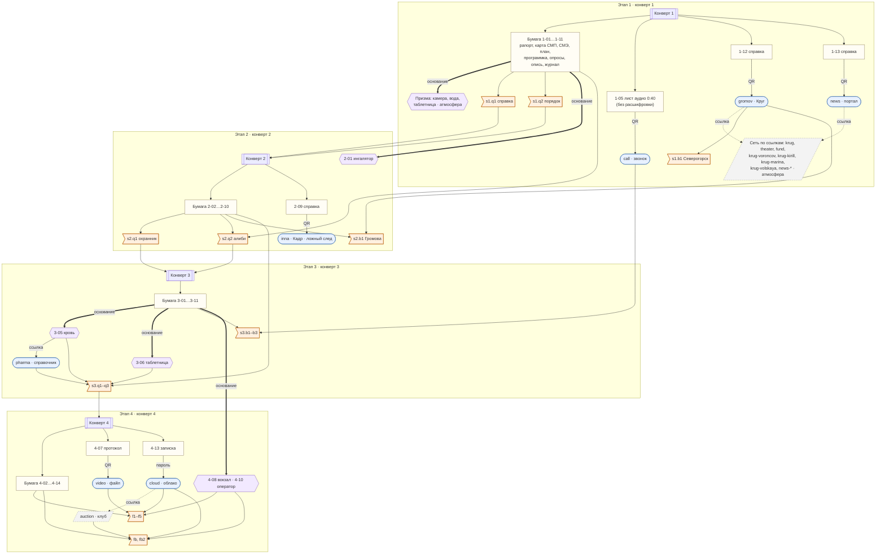
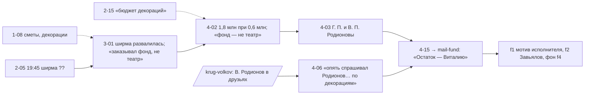

# Карта улик: бумага, сайты, экспертизы

Сценарист, 21.10.2026. Шаг 1 (днём): карта «как было» и предложение. **Шаг 2 (вечером): решения автора внесены в `content/`** — что именно, см. «3.А. Решения автора и что внесено» и актуальную схему 3.12. Раздел 2 описывает состояние **до** шага 2 и оставлен для сравнения.

Источники: `docs/SCENARIO.md` (раздел «Синхронизация» главнее), `docs/STORY-BIBLE.md`, `docs/STORY-CHANGES.md` (запись 21.10), `docs/REDESIGN-2026-10.md`, `docs/VOICES.md`, `content/stages.yaml`, `content/documents.yaml`, `content/expertise.yaml`, `content/pages/*`, `content/paper/*`, `content/documents/*`, `content/chats/*`.

Промпты для фото, аватарок и голосовых — `docs/drafts/pages/PHOTOS-2.md`.

## Оглавление

1. [Условные обозначения](#1-условные-обозначения)
2. [Как было (до шага 2)](#2-как-было-до-шага-2)
   - 2.1 Навигация: как попасть на каждую страницу
   - 2.2 Этап 1 · 2.3 Этап 2 · 2.4 Этап 3 · 2.5 Этап 4 — откуда берутся ответы
   - 2.6 Экспертизы «Призмы»
   - 2.7 Какие страницы несут улики, а какие только атмосферу
   - 2.8 Что нашлось при сверке
   - 2.9 Схемы
3. [Предложение и решения](#3-предложение-и-решения)
   - 3.А Решения автора и что внесено (21.10, вечер)
   - 3.0 Ограничения: что нельзя писать на открытых страницах
   - 3.1–3.10 Предложения по ценности
   - 3.11 Новые бонусы и баллы
   - 3.12 Схема после шага 2 (актуальная) и навигация
   - 3.13 Новые сюжетные детали (внесены)
   - 3.14 Линия денег: конверт 3 → 4-02/4-03 → 4-15 (25.10)
4. [Фото, голосовые, «жизнь» в соцсетях](#4-фото-голосовые-жизнь-в-соцсетях)
5. [Вопросы автору — решены 21.10](#5-вопросы-автору--решены-2110)

---

## 1. Условные обозначения

| Обозначение | Что значит |
|---|---|
| **бумага 1-08** | документ конверта (`content/paper/`), на руках у игроков с начала этапа |
| **QR → `gromov`** | страница открывается по QR-коду (или напечатанному адресу) с бумажного документа |
| **ссылка → `theater`** | страница открывается только переходом с другой страницы |
| **«Призма»: объект + основание → 3-05** | заключение выдаёт лаборатория, если введён объект из описи и выбрано основание |
| открытая | `locked: false`, видна с этапа 1 любому, кто знает адрес |
| закрытая (этап N) | ключ в QR-коде конверта N или в ссылке с закрытой страницы того же этапа |
| спящая улика | видна с этапа 1, смысл понятен только с документами поздних этапов |

На схемах: `[[Конверт]]`; прямоугольник — бумага; овал — страница по QR; параллелограмм — страница только по ссылке; шестиугольник — экспертиза; флажок — вопрос. Рёбра: `QR`, `ссылка`, `пароль`, `основание` (толстая стрелка) и сплошная стрелка без подписи — «нужно для вопроса».

---

## 2. Как было (до шага 2)

Состояние на 21.10, днём. Актуальное — в 3.А и 3.12.

### 2.1. Навигация: как попасть на каждую страницу

| Страница | Этап, доступ | Как попасть | Куда ведёт |
|---|---|---|---|
| `call` — запись звонка | 1, открытая | QR на 1-05 | — |
| `gromov` — Громова в «Круге» | 1, открытая | QR на 1-12 | `theater` (пост 10.11), `krug-voroncov` (пост 13.11), `krug` (логотип), `krug-private` (комментаторы) |
| `news` — статья портала | 1, открытая | QR на 1-13 | `theater`, `krug-voroncov` (статья), `news-yama`, `news-library`, `news-hockey` (боковая колонка) |
| `news-yama`, `news-library`, `news-hockey` | 1, открытые | ссылка из боковой колонки `news` и друг друга | `news`, друг друга |
| `krug` — главная «Круга» | 1, открытая | логотип на всех страницах «Круга», партнёры `theater` | «Популярное»: `krug-voroncov`, `theater`, `gromov`, `krug-kirill`, `krug-volskaya`, `news-yama`; поиск по открытым профилям |
| `krug-voroncov` | 1, открытая | `news`, `theater`, `gromov`, `krug`, друзья и комментарии других профилей | `krug-kirill`, `krug-marina`, `krug-volskaya`, `theater` |
| `krug-kirill` | 1, открытая | `krug`, `krug-voroncov`, `krug-marina` | `krug-voroncov`, `krug-marina` |
| `krug-marina` | 1, открытая | `krug-voroncov`, `krug-kirill` | `krug-kirill`, `krug-voroncov` |
| `krug-volskaya` | 1, открытая | `theater` («Друзья театра»), `krug`, `krug-voroncov` | `krug-voroncov`, `theater` |
| `krug-private` — заглушка | 1, открытая | любой автор без страницы | `krug` |
| `theater` — сайт ВОДТ | 1, открытая | `news`, `gromov`, `krug-voroncov`, `krug-volskaya`, `fund`, `krug` | `krug-voroncov`, `fund`, `krug-volskaya`, `news`, `krug` |
| `fund` — фонд «Сцена» | 1, открытая | `theater` (партнёры, карточка худрука) | `theater` |
| `inna` — Инна в «Кадре» | 2, закрытая | QR на 2-09 | — |
| `pharma` — справочник | 3, закрытая | ссылка в заключении 3-05 (химия крови; с 25.10, записка 3-09 с QR убрана) | — |
| `cloud` — облако погибшего | 4, пароль | QR на 4-13 + логин и пароль из 4-13 | `auction` (письмо «Если вы это читаете») |
| `video` — видеофайл Волкова | 4, закрытая | QR на 4-07 | — |
| `auction` — клуб «Закрытые вечера» | 4, закрытая | только ссылка из облака | — |

### 2.2. Этап 1 — откуда берутся ответы

| Вопрос | Суть | Ответ | Где факты | Как туда попасть |
|---|---|---|---|---|
| s1.q1.time | время констатации | 21:18 | бумага 1-03 (графа «Констатация смерти») | конверт 1 |
| s1.q1.conflict | с кем конфликт | Завьялов | бумага 1-08 (Лёвин: ссора в антракте); Завьялов («творческий спор») — 2-15, этап 2 | конверт 1 |
| s1.q1.disease | хроническое заболевание | астма | бумага 1-08 (Лёвин: «баллончик»; Резникова: «задыхался»), 1-03 («жаловался на дыхание», ингалятор у тела) — слово «астма» игроки выводят сами | конверт 1 |
| s1.q1.delivered | кто привёз в театр | Дмитрий (водитель) | бумага 1-08 (водитель: «забрала в 17:25, к 17:40 привезла», «к десяти будь у служебного входа»), 1-11 («а/м во дворе») | конверт 1 |
| s1.q2 | порядок 8 событий | 17:40 → 18:02 → 18:20 → 19:00 → ссора → 21:04 → 21:14 → 21:20 | 1-11 (17:40, 18:02), 1-08 Вольская (18:20), 1-07 (19:00, антракт), 1-08 Лёвин («в антракте»), 1-03 (21:04), 1-02 (21:14, 21:20) | конверт 1; сайт `theater` повторяет 19:00 (не нужен) |
| s1.b1 (бонус) | где Громова «официально» | Северогорск | **только страница `gromov`**: пост 12.11 в 19:30 с геометкой; пост 10.11 «буду в рабочей поездке в Северогорске». Бумага 1-12 — лишь справка с QR | QR на 1-12 |

Экспертизы этапа 1 — атмосфера, без документов: камера коридора (основание 1-06) — «неисправна с 29.10»; вода (1-09, 1-10) — «посторонних веществ нет»; таблетница (1-09, 1-10) — «без сведений о приёме не исследуется».

### 2.3. Этап 2 — откуда берутся ответы

| Вопрос | Суть | Ответ | Где факты | Как туда попасть |
|---|---|---|---|---|
| s2.q1 | охранник ушёл и вернулся | 19:35 и 19:50 (±2) | бумага 2-03 (кадры 19:35:12, 19:50:40), 2-04 (сначала «ни на минуту», после кадров — признание, «без десяти восемь»; с 25.10 — один протокол вместо 2-16 + 2-04) | конверт 2 |
| s2.q2 | чьё местонахождение 19:30–20:00 подтверждено | 9 человек; не подтверждены Завьялов, Волков, Кирилл, Инна | Марина — отметка в 1-14 (сестра, 19:10–20:05, отметка Беляева от 13.11 13:30; до 25.10 — 1-08); Лёвин — 2-05 (выходы); Резникова и Виктор — 2-07 (ПР/СВ), 2-05; Гнедич — 2-05 (звонок 19:45) и отметка в 2-13 (монтировщики); Олег и водитель — 2-03 (+ 2-04 Олег, 1-08 водитель); Вольская — 1-08 (подруга), 2-05 (19:38 бинокль); Громова — 1-02 (капельдинер), 1-08 (сотрудник охраны, Вольская), 2-05 (19:48) | конверты 1–2; сайты не нужны |
| s2.b1 (бонус) | почему Громова уходила | официально была на совещании в другом городе | `gromov` (пост 19:30, Северогорск) + 2-10 (справка пресс-службы) против 1-02 (21:20 в театре) | QR 1-12 + конверт 2 |

Экспертизы этапа 2: ингалятор — «химическое / содержимое» по основаниям 1-03, 1-08, 2-02 → **2-01** (исправен; тупик по сюжету); отпечатки на ингаляторе и повторы по таблетнице и наружной камере — атмосфера.

Страница `inna` (QR 2-09): фото в броши 13.11, брошь совпадает с описью 2-08. **Ни на один вопрос не работает**: ложный след без проверки.

### 2.4. Этап 3 — откуда берутся ответы

| Вопрос | Суть | Ответ | Где факты | Как туда попасть |
|---|---|---|---|---|
| s3.q1 | вещество, способное убить | пропранолол | «Призма»: кровь + химическое + основание 3-01, 2-02 или 1-04 → **3-05**; исключение «своих»: 2-02 и 3-04 (ингалятор, «Седарин», кофе), 2-01 (сальбутамол); что такое вещества — `pharma` или интернет | конверт 3, лаборатория, ссылка в 3-05 |
| s3.q2 | почему опасно | противопоказано при его болезни | `pharma` (противопоказания: бронхиальная астма; побочные: бронхоспазм) или интернет + 2-02 (астма); 3-05 против «передозировки» и «алкоголя» | ссылка в 3-05 и в 3-06 (S-121, 25.10; подсказка 2 говорит, где справочник) |
| s3.q3 | как попало + документ | подменили лекарство; 3-06 | «Призма»: таблетница + содержимое/химическое + основание 3-01, 3-04 или 3-05 → **3-06** (СБ — таблетка с риской, пропранолол); 2-02, 3-04 — «сам себе ничего не назначал» | лаборатория |
| s3.b1 (бонус) | план после спектакля (до 25.10, вечер; теперь — см. 3.15) | поезд, 23:40 | 3-07 (билет), 3-02 («на вокзал»), 3-08 (чемодан, билет в кармане) | конверт 3 |
| s3.b2 (бонус) | кто звонил анонимно | Кирилл | 1-05 (лист аудио 0:40, реплик нет) + `call` (запись; голос изменён, узнаётся по фразе только на слух) — «Было бы за что» ↔ 3-04 (та же фраза дважды) | конверты 1 и 3, QR 1-05 |
| s3.b3 (бонус) | зачем Громова была в театре | встреча с Завьяловым о деньгах фонда | 2-06 **фото 2** (папка «Фонд „Сцена“: отчёт для администрации города», две чашки, помада; с 25.10 в тексте фототаблицы предметы не перечислены) + 3-10 («неофициальная встреча… вопросы отчётности», 18:30–18:55, 2-й этаж) + 2-15/`theater` (Завьялов — председатель фонда) | конверты 2–3 |

### 2.5. Этап 4 — откуда берутся ответы

| Вопрос | Суть | Ответ | Где факты | Как туда попасть |
|---|---|---|---|---|
| f1 | исполнитель | Волков | **`video`**: файл создан 10.11.2026 14:12:03 на «Альтаир A54» (дата есть **только** на странице, в протоколе 4-07 её нет); 2-17 (видео предъявлено на «Альтаир A54», опрос 13.11; до 24.10 — 1-08); 3-03 (вход 19:40 с «Альтаир A54», сеть театра, прежний пароль); `cloud` → журнал входов; 4-09 (у гримёрки № 4 в 21:08); «Призма» → 4-08 (у колонны 01.11); 4-06 (дежурство на 3-м этаже); 1-06 (служебная лестница) | QR 4-07, пароль 4-13, лаборатория |
| f2 | кто ещё причастен | Завьялов | 4-04 (Анаприлин куплен 10.11 раньше графика), 2-06 (упаковка на столе), 4-05 (запрет ремонта камеры), 4-06 (поставил Волкова на 3-й этаж), 4-02 + 4-03 (переплата фирме Родионовых), `mail-fund` по QR 4-15 (25.10: «Остаток — Виталию», «Такие вещи не пишут. Позвоните»; след на этапе 3 — 3-01, ширма, «заказывал фонд, не театр»), `cloud` (ультиматум), 2-02 и 3-04 (о ночной таблетке знали Марина, Кирилл, Завьялов; Волков не мог) | конверты 2–4, пароль |
| f3 | откуда препарат | из лекарств Завьялова | 4-04 («Анаприлин… (пропранолол)», рецепт Завьялова); `pharma` (Анаприлин = пропранолол) | конверт 4 |
| f4 | мотив | архив и угроза разоблачить «Закрытые вечера» | **`cloud`**: реестр, переписка 14.09, письмо «Если вы это читаете»; 3-04 («мёртвая рука»), 3-03 (попытка входа), 1-05 («собирался всё рассказать… кому это мешало» — без денег и фамилий) | пароль 4-13 |
| f5 | почему на сцене | принял раньше, после ссоры | 2-02 («на ночь… или когда совсем нервничал»), 3-07 (поезд 23:40), 3-01 (20:25, руки тряслись), 3-11 (взвинчен), 3-06 (ЧТ пусто; до сдвига дат +2 — ВТ), 3-05 (в пределах двух часов) | конверты 2–3, лаборатория |
| fb (бонус) | кто вынес телефон | Завьялов | 1-11 (вышел 22:05, Волков — 23:10), «Призма»: телефон + оператор + основание 1-09 или 3-03 → **4-10** (22:15, БС «Речной мост»), 4-04 (Заречная, «правый берег, остановка „Речной мост“»), 2-04 и 3-02 (прошёл через двор около 22:05) | конверт 4, лаборатория |
| fb2 (бонус) | кто знал, что табакерка — копия, уже при продаже | Воронцов и Завьялов | **`cloud`**: реестр («З. знал, что копия», внесено 16.11.2024 «без правок»), переписка 14.09 («ты знал… я тоже знал»); 4-11 (Вольская узнала 17.10.2026), 3-04 и 4-13 (Кирилл в архив не заходил); `auction` (витрина: «подлинник, рекорд клуба») | пароль 4-13 → ссылка |

### 2.6. Экспертизы «Призмы» (сводка)

| Результат | Объект (с этапа) | Вид | Основания | Итог |
|---|---|---|---|---|
| theater-cam | камера в коридоре (1) | видео | 1-06 | атмосфера: «неисправна с 29.10» |
| archive-cam | архивная камера, балкон (1; 25.10) | видео | 1-15, 1-06, 1-07, 1-02 | атмосфера: запись уже в деле, снимает только сцену; алиасы только сочетания («архивн камер», «архив спектакл»…), голое «архив» убрано (S-119) |
| water-chem | бутылка воды (1) | химия | 1-09, 1-10 | атмосфера: «чисто» |
| pillbox-early-1 / -2 | таблетница (1) | содержимое, химия, отпечатки | 1-09, 1-10 / 2-02 | атмосфера: «не исследуется» |
| inhaler-chem | ингалятор (2) | химия, содержимое | 1-03, 1-08, 2-02 | **2-01** |
| inhaler-prints | ингалятор (2) | отпечатки | те же | атмосфера |
| outer-cam | наружная камера (2) | видео | 2-03, 2-04 | атмосфера |
| blood-chem | кровь (3) | химия | 3-01, 2-02, 1-04 | **3-05** |
| pillbox-content | таблетница (1) | содержимое, химия | 3-01, 3-04, 3-05 | **3-06** |
| pillbox-prints | таблетница (1) | отпечатки | 3-01, 3-04, 3-05 | атмосфера |
| phone-operator | телефон погибшего (4) | оператор | 1-09, 3-03 | **4-10** |
| station-video | камеры вокзала (4) | видео + дата, время ±7, касса | 3-07 | **4-08** |

### 2.7. Какие страницы несут улики, а какие — атмосферу

| Страница | Роль сейчас | Без неё решается? |
|---|---|---|
| `gromov` | **улика**: s1.b1 (единственный источник на этапе 1), s2.b1 | s1.b1 — нет; s2.b1 — частично по 2-10 |
| `video` | **улика**: f1 (дата и устройство файла есть только здесь) | f1 решается и без даты (4-09, 4-08, журнал входов), но алиби Волкова ломается только здесь |
| `cloud` | **улика**: f4, fb2, журнал входов для f1 | нет |
| `pharma` | помогает: s3.q1, s3.q2 (запасной путь к интернету) | да, через интернет |
| `call` | помогает: s3.b2 (запись, голос изменён; фраза «Было бы за что» есть только в записи и в 3-04; в бумаге 1-05 расшифровки нет — сопроводительный лист аудио 0:40 без реплик, решение автора 24.10) | да |
| `inna` | ложный след, ни на один вопрос не работает | да |
| `auction` | подтверждение fb2 (витрина «подлинник» против реестра) | да |
| `news`, `news-yama`, `news-library`, `news-hockey` | атмосфера | — |
| `theater`, `fund` | атмосфера, мелкие подтверждения 1-07 и 1-08 | — |
| `krug`, `krug-voroncov`, `krug-kirill`, `krug-marina`, `krug-volskaya`, `krug-private` | атмосфера, мелкие подтверждения 1-08 и 1-14 (крестница не пошла на премьеру, Кирилл ходит «на десятый спектакль», ложа № 2) | — |

**Итого:** улики, без которых не обойтись, есть на трёх страницах: `gromov`, `video`, `cloud`. Все три открываются по QR или паролю с бумаги. **Ни одна страница «только по ссылке» сейчас не несёт ни одной улики**: переходы по сети — прогулка без находок. Это и есть замечание автора.

### 2.8. Что нашлось при сверке

1. **3-06 ссылается на описание «Седарина» в инструкции** («по внешнему виду… соответствуют описанию препарата „Седарин“ в инструкции»), но внешнего вида таблеток нет нигде: в `pharma` у карточек нет такого поля (STORY-CHANGES 21.10: «в схеме карточек нет такого поля»). Улика не до конца находима — см. предложение 3.6.
2. **Упаковка «Анаприлина» на фото 2-06** (`media/paper/2-06-office.jpg`) — бело-синяя коробочка на бумагах, надпись не читается даже при увеличении. По SCENARIO она должна читаться при увеличении. Сейчас это просто деталь, f3 решается и без неё (4-04). Решение автора: перегенерировать кадр или оставить.
3. **`inna`** — единственная закрытая страница этапа 2, но ни один вопрос её не требует. Ложный след нечем закрыть, кроме развязки (судьба Инны).
4. **Правило REDESIGN §4.4 о датах и времени на открытых страницах** проверяют иголки-значения (ответы всех этапов, параметры экспертиз, `leak_watchlist`, пароль, названия документов этапов 2–4) и шинглы закрытых текстов: проза открытых страниц их больше не отбеливает (docs/02 §5а; раньше строки открытых страниц считались «открытыми по замыслу» и шинглы там не ловились). Законные повторы — `settings.leak_public_ok`.
5. **Даты постов показываются как `ДД.ММ.ГГГГ, ЧЧ:ММ`** (фильтр `dt`). Значит, **любой пост на открытой странице с датой 01.11.2026** совпадёт с параметром экспертизы вокзала и уронит leak scan; время поста 14:30–14:44, 19:33–19:37, 19:48–19:52, 21:18 или 23:40 — тоже.
6. **«Кружки» у Марины** — места для правки на шаге 2 (решение автора 21.10: только голосовые):
   - `content/pages/krug-marina/page.yaml`: строки 2–3 (комментарий шапки), 18 (`about: "english teacher · кружки > текст 🤗"`), 25 (пост 13.11: «даже кружок не получается записать»), 32 (пост 12.11: «🎥 кружок · 0:24»), 38 (пост 02.11: «🎥 кружок · 0:41»), 44 (пост 20.10: «🎥 кружок · 0:17»), 50 (пост 29.09: «🎥 кружок · 0:09»);
   - те же строки в черновике `docs/drafts/pages/krug-marina/page.yaml`;
   - упоминания в документах: `docs/REDESIGN-2026-10.md` (строка 173, «Марина: немного постов, «кружки»»), `docs/STORY-CHANGES.md` (строка 476), `docs/VOICES.md` (строки 16 и 82 — «любит кружки», «видеокружки»).
   - В `content/pages/krug-kirill/page.yaml` слово «драмкружок» — это кружок самодеятельности, не видео, править не нужно.

### 2.9. Схемы «как было»

#### Обзор



#### Этап 1

```mermaid
flowchart TD
  E1[["Конверт 1 · папка дела"]]
  subgraph PAPER1["Бумага конверта 1"]
    D102["1-02 рапорт: 21:14, 21:20 Громова у лож"]
    D103["1-03 карта СМП: 21:04, 21:18, ингалятор у тела"]
    D104["1-04 СМЭ: кровь отобрана"]
    D105["1-05 лист аудио 0:40 + QR (реплик нет)"]
    D106["1-06 план: камера неисправна, служебная лестница"]
    D107["1-07 программка: 19:00, антракт"]
    D108["1-08 объяснения 5 человек"]
    D114["1-14 крестница 13.11: близкие, сестра"]
    D109["1-09 опись: телефона нет, таблетница"]
    D110["1-10 фото гримёрки"]
    D111["1-11 журнал охраны: 17:40, 18:02"]
    D112["1-12 справка + QR"]
    D113["1-13 справка + QR"]
  end
  subgraph WEB1["Страницы этапа 1"]
    Wcall(["call · запись звонка"])
    Wgromov(["gromov · пост 12.11 19:30, Северогорск"])
    Wnews(["news · сердечный приступ"])
    Wnewsx[/"news-yama, news-library, news-hockey"/]
    Wtheater[/"theater · сайт театра"/]
    Wfund[/"fund · фонд Сцена"/]
    Wkrug[/"krug · главная Круга"/]
    Wkv[/"krug-voroncov"/]
    Wkk[/"krug-kirill"/]
    Wkm[/"krug-marina"/]
    Wkvol[/"krug-volskaya"/]
    Wpriv[/"krug-private"/]
  end
  subgraph LAB1["Призма · этап 1"]
    Lcam{{"камера коридора: неисправна"}}
    Lwater{{"вода: чисто"}}
    Lpill{{"таблетница: не исследуется"}}
  end
  subgraph QS1["Вопросы этапа 1"]
    Qtime>"s1.q1 время констатации · 21:18"]
    Qconf>"s1.q1 конфликт · Завьялов"]
    Qdis>"s1.q1 болезнь · астма"]
    Qdel>"s1.q1 кто привёз · водитель"]
    Qord>"s1.q2 порядок событий"]
    Qb1>"s1.b1 бонус · Северогорск"]
  end
  E1 --> D102 & D103 & D104 & D105 & D106 & D107 & D108 & D109 & D110 & D111 & D112 & D113 & D114
  D105 -->|QR| Wcall
  D112 -->|QR| Wgromov
  D113 -->|QR| Wnews
  Wgromov -.->|ссылка| Wtheater
  Wgromov -.->|ссылка| Wkv
  Wgromov -.->|ссылка| Wkrug
  Wnews -.->|ссылка| Wtheater
  Wnews -.->|ссылка| Wkv
  Wnews -.->|ссылка| Wnewsx
  Wtheater -.->|ссылка| Wfund
  Wtheater -.->|ссылка| Wkvol
  Wtheater -.->|ссылка| Wkrug
  Wkrug -.->|ссылка| Wkk
  Wkv -.->|ссылка| Wkk
  Wkv -.->|ссылка| Wkm
  Wkv -.->|ссылка| Wkvol
  Wkv -.->|ссылка| Wpriv
  D106 ==>|основание| Lcam
  D109 ==>|основание| Lwater
  D110 ==>|основание| Lwater
  D109 ==>|основание| Lpill
  D103 --> Qtime
  D108 --> Qconf
  D108 --> Qdis
  D103 --> Qdis
  D108 --> Qdel
  D111 --> Qdel
  D111 --> Qord
  D108 --> Qord
  D107 --> Qord
  D103 --> Qord
  D102 --> Qord
  Wgromov --> Qb1
  classDef paper fill:#fffdf5,stroke:#8a7a55;
  classDef qr fill:#e8f1ff,stroke:#3b6db3;
  classDef lnk fill:#f3f3f3,stroke:#999,stroke-dasharray:4 3;
  classDef lab fill:#f2e9ff,stroke:#7a4fb3;
  classDef q fill:#fff0e0,stroke:#c07020;
  class D102,D103,D104,D105,D106,D107,D108,D109,D110,D111,D112,D113,D114 paper;
  class Wcall,Wgromov,Wnews qr;
  class Wnewsx,Wtheater,Wfund,Wkrug,Wkv,Wkk,Wkm,Wkvol,Wpriv lnk;
  class Lcam,Lwater,Lpill lab;
  class Qtime,Qconf,Qdis,Qdel,Qord,Qb1 q;
```



#### Этап 2

```mermaid
flowchart TD
  E2[["Конверт 2"]]
  subgraph OLD2["Из конверта 1"]
    D102["1-02 рапорт: капельдинер, 21:20"]
    D103["1-03 ингалятор у тела"]
    D108["1-08 объяснения: отметки о подруге, охране"]
    D114["1-14 крестница: отметка о сестре"]
    D213["2-13 Гнедич: монтировщики"]
    Wgromov(["gromov · Северогорск 19:30"])
  end
  subgraph PAPER2["Бумага конверта 2"]
    D202["2-02 Марина: астма, Седарин на ночь"]
    D203["2-03 наружная камера: 19:35:12, 19:50:40"]
    D204["2-04 охранник: «ни на минуту» → кадры → перекур"]
    D205["2-05 журнал помрежа"]
    D206["2-06 кабинет худрука: папка фонда, две чашки"]
    D207["2-07 журнал светового пульта"]
    D208["2-08 опись костюмерки: нет броши"]
    D209["2-09 справка + QR"]
    D210["2-10 справка пресс-службы"]
  end
  Winna(["inna · Кадр: фото в броши 13.11"])
  subgraph LAB2["Призма · этап 2"]
    L201{{"ингалятор → 2-01: исправен"}}
    Lprn{{"отпечатки, наружная камера,<br/>таблетница · атмосфера"}}
  end
  subgraph QS2["Вопросы этапа 2"]
    Q21>"s2.q1 охранник · 19:35 / 19:50"]
    Q22>"s2.q2 подтверждённое алиби · 9 человек"]
    B21>"s2.b1 бонус · Громова прогуляла совещание"]
  end
  E2 --> D202 & D203 & D204 & D205 & D206 & D207 & D208 & D209 & D210
  D209 -->|QR| Winna
  D208 -.- Winna
  D103 ==>|основание| L201
  D108 ==>|основание| L201
  D202 ==>|основание| L201
  D202 ==>|основание| Lprn
  D203 ==>|основание| Lprn
  D203 --> Q21
  D204 --> Q21
  D203 --> Q22
  D205 --> Q22
  D207 --> Q22
  D108 --> Q22
  D114 --> Q22
  D213 --> Q22
  D102 --> Q22
  Wgromov --> B21
  D210 --> B21
  D102 --> B21
  classDef paper fill:#fffdf5,stroke:#8a7a55;
  classDef qr fill:#e8f1ff,stroke:#3b6db3;
  classDef lab fill:#f2e9ff,stroke:#7a4fb3;
  classDef q fill:#fff0e0,stroke:#c07020;
  class D102,D103,D108,D114,D213,D202,D203,D204,D205,D206,D207,D208,D209,D210 paper;
  class Wgromov,Winna qr;
  class L201,Lprn lab;
  class Q21,Q22,B21 q;
```



Пунктир без стрелки 2-08 — `inna`: брошь совпадает, но вопрос этого не спрашивает.

Опросы Беляева 13.11 (конверт 2, решение автора 24.10): 2-11 Кузнецов (свет), 2-12 Рябова (кофе, чашки — основа s2.b2 и s3.q1, исключение «своих»), 2-13 Гнедич (монтировщики — подтверждение в s2.q2), 2-14 Кирилл (без фразы-привычки: она только в записи и в 3-04). Материала для ответов этапа 1 в них нет.

#### Этап 3

```mermaid
flowchart TD
  E3[["Конверт 3"]]
  subgraph OLD3["Из конвертов 1–2"]
    D104["1-04 кровь отобрана"]
    D105["1-05 звонок: Было бы за что"]
    Wcall(["call · голос"])
    D202["2-02 астма, свои лекарства"]
    D206["2-06 папка фонда, две чашки"]
    D215["2-15 Завьялов — председатель фонда"]
  end
  subgraph PAPER3["Бумага конверта 3"]
    D301["3-01 Резникова: 20:25 что-то запил из чёрной коробочки"]
    D302["3-02 водитель: вокзал, чемодан"]
    D303["3-03 снимки Кирилла: вход 19:40, Альтаир A54"]
    D304["3-04 Кирилл: облако, мёртвая рука, Было бы за что"]
    D307["3-07 билет: 23:40, куплен 01.11 14:37, касса 2"]
    D308["3-08 осмотр машины: чемодан, 400 тыс."]
    D310["3-10 объяснение Громовой"]
    D311["3-11 Вольская: Табакерку пока никому"]
  end
  Wpharma(["pharma · справочник: противопоказания"])
  subgraph LAB3["Призма · этап 3"]
    L305{{"кровь → 3-05: пропранолол"}}
    L306{{"таблетница → 3-06: СБ с риской"}}
  end
  subgraph QS3["Вопросы этапа 3"]
    Q31>"s3.q1 вещество · пропранолол"]
    Q32>"s3.q2 почему опасно · противопоказание"]
    Q33>"s3.q3 подмена + 3-06"]
    B31>"s3.b1 бонус: почему к десяти — поезд (25.10, вечер)"]
    B32>"s3.b2 бонус · звонил Кирилл"]
    B33>"s3.b3 бонус · встреча о деньгах фонда"]
  end
  E3 --> D301 & D302 & D303 & D304 & D307 & D308 & D310 & D311
  L305 -->|ссылка| Wpharma
  D301 ==>|основание| L305
  D202 ==>|основание| L305
  D104 ==>|основание| L305
  D301 ==>|основание| L306
  D304 ==>|основание| L306
  L305 ==>|основание| L306
  L305 --> Q31
  D202 --> Q31
  Wpharma --> Q31
  Wpharma --> Q32
  D202 --> Q32
  L306 --> Q33
  D202 --> Q33
  D307 --> B31
  D302 --> B31
  D308 --> B31
  D105 --> B32
  Wcall --> B32
  D304 --> B32
  D206 --> B33
  D310 --> B33
  D215 --> B33
  classDef paper fill:#fffdf5,stroke:#8a7a55;
  classDef qr fill:#e8f1ff,stroke:#3b6db3;
  classDef lab fill:#f2e9ff,stroke:#7a4fb3;
  classDef q fill:#fff0e0,stroke:#c07020;
  class D104,D105,D202,D206,D215,D301,D302,D303,D304,D307,D308,D310,D311 paper;
  class Wcall,Wpharma qr;
  class L305,L306 lab;
  class Q31,Q32,Q33,B31,B32,B33 q;
```



#### Этап 4

```mermaid
flowchart TD
  E4[["Конверт 4"]]
  subgraph OLD4["Из конвертов 1–3"]
    D106["1-06 служебная лестница"]
    D217["2-17 видео на Альтаир A54"]
    D109["1-09 телефона нет"]
    D111["1-11 Завьялов ушёл 22:05"]
    D202["2-02 Седарин на ночь; кто знал"]
    D206["2-06 упаковка на столе"]
    D301["3-01 20:25 таблетка"]
    D303["3-03 вход 19:40, Альтаир A54"]
    D304["3-04 мёртвая рука; кто знал"]
    D307["3-07 билет 01.11 14:37 касса 2"]
    D311["3-11 Вольская"]
    L306{{"3-06 ЧТ пусто, СБ чужая"}}
  end
  subgraph PAPER4["Бумага конверта 4"]
    D402["4-02 смета 1,8 млн и справка 0,6 млн"]
    D403["4-03 выписка: Родионовы"]
    D404["4-04 аптека: Анаприлин 10.11, Заречная"]
    D405["4-05 записка: камеру не чинить"]
    D406["4-06 чат: Волков на 3-м этаже; Родионов"]
    D407["4-07 протокол копирования видео + QR"]
    D409["4-09 Гнедич: Волков у № 4 в 21:08"]
    D411["4-11 эксперт: табакерка — копия"]
    D412["4-12 переписка Вольской"]
    D413["4-13 записка Кирилла: логин, пароль, QR"]
    D414["4-14 Марина: знала об отъезде"]
  end
  subgraph WEB4["Страницы этапа 4"]
    Wvideo(["video · создан 10.11 14:12:03"])
    Wcloud(["cloud · реестр, ультиматум, письмо, журнал входов"])
    Wauction[/"auction · витрина клуба"/]
  end
  subgraph LAB4["Призма · этап 4"]
    L408{{"вокзал → 4-08: человек у колонны"}}
    L410{{"оператор → 4-10: 22:15 Речной мост"}}
  end
  subgraph QS4["Финал и бонусы"]
    F1>"f1 исполнитель · Волков"]
    F2>"f2 причастен · Завьялов"]
    F3>"f3 препарат · лекарства Завьялова"]
    F4>"f4 мотив · архив"]
    F5>"f5 почему на сцене · раньше"]
    FB>"fb бонус · телефон вынес Завьялов"]
    FB2>"fb2 бонус · знали Воронцов и Завьялов"]
  end
  E4 --> D402 & D403 & D404 & D405 & D406 & D407 & D409 & D411 & D412 & D413 & D414
  D407 -->|QR| Wvideo
  D413 -->|пароль| Wcloud
  Wcloud -.->|ссылка| Wauction
  D307 ==>|основание| L408
  D109 ==>|основание| L410
  D303 ==>|основание| L410
  Wvideo --> F1
  D217 --> F1
  D303 --> F1
  Wcloud --> F1
  D409 --> F1
  L408 --> F1
  D406 --> F1
  D106 --> F1
  D404 --> F2
  D405 --> F2
  D406 --> F2
  D402 --> F2
  D403 --> F2
  D202 --> F2
  D304 --> F2
  D404 --> F3
  D206 --> F3
  Wcloud --> F4
  D304 --> F4
  D202 --> F5
  D307 --> F5
  D301 --> F5
  L306 --> F5
  D111 --> FB
  L410 --> FB
  D404 --> FB
  Wcloud --> FB2
  D411 --> FB2
  D412 --> FB2
  D311 --> FB2
  Wauction --> FB2
  classDef paper fill:#fffdf5,stroke:#8a7a55;
  classDef qr fill:#e8f1ff,stroke:#3b6db3;
  classDef lnk fill:#f3f3f3,stroke:#999,stroke-dasharray:4 3;
  classDef lab fill:#f2e9ff,stroke:#7a4fb3;
  classDef q fill:#fff0e0,stroke:#c07020;
  class D106,D217,D109,D111,D202,D206,D301,D303,D304,D307,D311,D402,D403,D404,D405,D406,D407,D409,D411,D412,D413,D414 paper;
  class Wvideo,Wcloud qr;
  class Wauction lnk;
  class L306,L408,L410 lab;
  class F1,F2,F3,F4,F5,FB,FB2 q;
```



---

## 3. Предложение и решения

> **25.10, решения автора:** Марина опрошена 13.11 утром Беляевым — **1-14** (конверт 1; отметка о сестре там); 1-08 — 5 объяснений; опрос Олега — один, **2-04** (13.11 16:15–16:50: «ни на минуту» → кадры 2-03, изъятые 13.11 в 14:10 → перекур), 2-16 удалён; 2-02 переписан (Беляев сам выкладывает то, что узнал из 1-03 и 1-08; Марина часть не знает). «Тёма» — только Марина и Кирилл; коллеги — «Артём».
>
> **24.10 (вечер), решение автора:** 1-08 — «Объяснения» 12.11 (6 человек: Громова, Вольская, Лёвин, Резникова, Марина, водитель), берёт оперуполномоченный СОГ; Завьялов, Олег, Волков — первые опросы Беляева 13.11 в конверте 2: **2-15** (Завьялов), **2-16** (Олег), **2-17** (Волков, модель телефона для f1). Номера в таблицах и схемах ниже обновлены там, где сместились; схема этапа 2 (D108 «отметки о сестре, подруге, охране») не менялась.

### 3.А. Решения автора и что внесено (21.10, вечер)

| № | Предложение | Решение автора | Что внесено в `content/` |
|---|---|---|---|
| 3.1 | фото из гримёрки 30.10 | **да**, подпись смягчена: «отмечаюсь, что на месте» (не эхо признания R-01) | `krug-voroncov`: пост 30.10 15:52, фото VR-02; бонус **fb3** в `stages.yaml` |
| 3.2 | страница дублёра | **да** + страница Лёвина для баланса | новые `krug-volkov` (кредитор в друзьях, комментарий 27.10) и `krug-levin` (без улик, автор фото 30.10); ссылки: «Труппа» на `theater`, друзья и комментарии у `krug-voroncov`, друзья друг у друга |
| 3.3 | брошь, бонус s2.b2 | **да** | бонус **s2.b2** в `stages.yaml`; `inna`: пост 11.11 17:30 (IN-10, костюм с брошью у буфета) |
| 3.4 | голосовое и селфи 02.11 | принято | `krug-voroncov`: пост 02.11 10:12, фото VR-03 + голосовое V1 |
| 3.5 | мост | **вариант А**: только новость, 4-04 не трогаем | новая `news-most`; ссылка из боковых колонок `news`, `news-yama`, `news-library`, `news-hockey` |
| 3.6 | внешний вид таблеток | **да**, «не слишком палевно» (уточнение режиссёра) | `pharma`: поле `appearance` у всех 9 препаратов, один стиль; белые круглые с риской — у 4, гравировка — у 3 («S», «10», «5»), оболочка — у 2, капсулы — у 1; без общих четвёрок слов с 3-06 |
| 3.7 | Кирилл 22.10 и 07.11 | принято | `krug-kirill`: оба поста; **голосовых у Кирилла нет** |
| 3.8 | фонд, клуб, Громова | принято; личные посты Громовой — **да** | `fund`: строка об отчёте за 2025 год; `auction`: ссылка на `fund`, «подлинность подтверждает казначей клуба»; `gromov`: личные 20.10, 27.10, 03.11 и официальный 29.10 |
| 3.9 | крестница 05.11, голосовые | принято | `krug-marina`: «кружки» убраны, 12.11 и 02.11 — голосовые V2, V3; пост 05.11 (формулировка не повторяет 4-14) |
| 3.10 | Вольская 17.10 | принято | `krug-volskaya`: 17.10, плюс жизнь 27.09 и 03.11 (голосовое V4) |
| 3.11 | баллы и ранги, фраза-подталкивание | **да** | максимум **285**; ранги до 119 / 120–224 / от 225 (`settings.yaml`, `docs/01`); фраза Беляева — во вводном письме этапа 3 |
| 2.8 п. 2 | фото 2-06 | **перегенерировать** | промпт — `PHOTOS-2.md`, раздел 2а; текст 2-06 не меняется |
| 4.1 | 30–50 % постов «про жизнь», фото и аватарки | **да** | см. 4.1–4.4 (ниже — фактические числа) |

`settings.leak_public_ok` не менялся: все совпадения с закрытыми текстами сняты перефразом (единственное — время поста Лёвина совпадало с хвостом даты поста Инны, «…11.2026, 08:15», — перенесено на 08:20). Иголок-значений на открытых страницах нет: ни 01.11, ни 14:30–14:44, ни 19:33–19:37, 19:48–19:52, 21:18, 23:40.


**Цель:** чтобы 4–7 страниц несли настоящие факты, нужные для ответа или сильно помогающие, и чтобы страницы «только по ссылке» стоило открывать. Приём — **спящие улики**: на открытых страницах этапа 1 видно с первой минуты, понятно только с бумагой этапов 3–4. Игроки гуляют по сети на этапе 1 ради атмосферы, а на этапах 3–4 у них появляется причина вернуться: «где-то я это уже видел».

**Что не меняется:** ответы, ID, пути единиц, соли, обязательные вопросы и их подсказки, бумага конвертов (кроме одного необязательного варианта в 3.5), экспертизы.

### 3.0. Ограничения: что нельзя писать на открытых страницах

Иголки-значения, которые сборка ищет на открытых страницах (см. 2.8 п. 4–5):

| Что | Значения |
|---|---|
| ответы этапа 1 | «21:18»; «астма», «астму», «бронхиальная астма» и формы (`Северогорск` — можно, у бонуса `leak_scan: false`) |
| ответы этапов 2–3 | время **19:33–19:37** и **19:48–19:52**, **23:40**; «пропранолол», «анаприлин», «обзидан», «propranolol» |
| параметры вокзала | дата **01.11.2026** (и `2026-11-01`), время **14:30–14:44** |
| `leak_watchlist` | «седарин», «VID_20261110», «знал, что копия», «Сценическая мастерская» |
| пароль облака | `Nina-1835` |
| названия документов этапов 2–4 | например, «Журнал помощника режиссёра», «Железнодорожный билет», «Ответ оператора связи», «Записи камер вокзала», «Письмо эксперта-оценщика» |

Дата и время поста показываются в тексте страницы, поэтому **ни один пост на открытой странице не датируется 01.11 и не ставится на перечисленное время**. Плюс сюжетные запреты REDESIGN §4.4: фразы «Было бы за что» нигде; ООО, откаты, табакерка, таблетки, отравление, астма, аукционы — не на открытых страницах; легенда Громовой («была в Северогорске») не опровергается. Поезд, вокзал, чемодан и отъезд — тоже нет (SCENARIO 2-02, 4-12; S-22).

### Сводная таблица (по убыванию ценности)

| № | Что | Где | На что работает | Новый вопрос? | Ценность |
|---|---|---|---|---|---|
| 3.1 | «Отмечаюсь, что живой»: фото из гримёрки 30.10, дублёр смотрит в телефон через плечо | `krug-voroncov` (ссылка) | этапы 3–4: при ком вводил пароль; f1; новый бонус fb3 | да, fb3 | высокая |
| 3.2 | Страница дублёра: кредитор Родионов в друзьях и в комментарии «как освободишься — набери. Разговор есть» | новая `krug-volkov` (ссылка) | этап 4: долг Волкова ↔ 4-03, 4-06; f1, f2, f4 | нет | высокая |
| 3.3 | Брошь из костюмерки: бонус «что скрывает буфетчица» | `inna` (QR 2-09) + 2-08 | этап 2, новый бонус s2.b2 | да, s2.b2 | высокая |
| 3.4 | «Кто-то идёт следом»: голосовое и селфи 02.11 с фигурой в короткой тёмной куртке | `krug-voroncov` (ссылка) | этап 4: слежка 01.11 ↔ 4-08; f1 | нет | средняя–высокая |
| 3.5 | Мост через Речку: новость про дорогу из центра в Заречье | новая `news-most` (ссылка) | fb: 1-11 + 4-10 + 4-04 | нет | средняя (высокая в варианте Б) |
| 3.6 | Внешний вид таблеток в справочнике | `pharma` (ссылка в 3-05; до 25.10 — QR 3-09) | s3.q3 (закрывает ссылку 3-06 на «инструкцию»), f3 | нет | средняя |
| 3.7 | Кирилл 22.10 и 07.11: «чтобы надёжно», «пароль как зубная щётка» | `krug-kirill` (ссылка) | этап 3: 3-03, 3-04; s3.b2, f4 | нет | средняя |
| 3.8 | Отчёт фонда для администрации; витрина клуба ссылается на фонд; личные посты Громовой | `fund`, `auction`, `gromov` | s3.b3, fb2 | нет | средняя–низкая |
| 3.9 | Крестница 05.11: «чай так и не выпил»; голосовые вместо «кружков» | `krug-marina` (ссылка) | этап 4: 4-14, журнал облака 05.11 | нет | низкая (эмоция) |
| 3.10 | Вольская 17.10: «новости, после которых хочется молчать» | `krug-volskaya` (ссылка) | этап 4: 4-11, 4-12 | нет | низкая |

После 3.1–3.7 улики несут **9 страниц**: `gromov`, `video`, `cloud` (как сейчас), `inna`, `pharma` (усилены), `krug-voroncov`, `krug-volkov`, `news-most`, `krug-kirill` (новые). Из них **только по ссылке** — четыре.

---

### 3.1. «Отмечаюсь, что на месте» — фото из гримёрки 30.10 (`krug-voroncov`) — внесено

**Что.** Новый пост погибшего, 30.10.2026 в 15:52, с фото. Гримёрка № 4, перерыв на репетиции. Воронцов сидит у гримировального зеркала в репетиционной рубашке и очках, держит телефон и набирает что-то одним пальцем. За его плечом, наклонившись, стоит дублёр и смотрит в экран, улыбается. Экран к камере не повёрнут. Снимал Лёвин (из дверей).

Текст (манера Воронцова: строчные, без точки, «)», 😁):

```yaml
- datetime: "2026-10-30T15:52"
  text: "перерыв между сценами\nотмечаюсь, что на месте 😁\nфото — {{ c.stas.first() }}, {{ c.stas.g('он', 'она') }} считает, что это искусство"   # смягчено 21.10
  photo: "krug-voroncov/02.jpg"        # УЛИКА, промпт VR-02 в PHOTOS-2.md
  likes: 118
  comments:
    - { author: "{{ c.stas.first() }} {{ c.stas.last() }}", text: "Я тебе как {{ c.stas.g('артист', 'артистка') }} скажу: композиция — Чехов, не меньше! Все смотрят в одну точку 🎭" }
    - { author: "{{ c.volkov.first() }} {{ c.volkov.last() }}", page: krug-volkov, text: "Учусь у лучших 👌" }   # page — если принята 3.2
    - { author: "{{ c.reznikova.first() }} {{ c.reznikova.last() }}", text: "Перерыв — десять минут, а не двадцать. Напоминаю." }
    - { author: "{{ c.marina.first() }} {{ c.marina.last() }}", page: krug-marina, text: "ахахах как в кино 🤗" }
```

Кирилл под этим постом не комментирует: о том, что пароль вводили при людях, он узнал только 06.11 (3-03, 3-04).

**Как работает.**
- Этап 1–2: обычный закулисный снимок, шутка про возраст и нервы перед премьерой.
- Этап 3: 3-04 — «подтверждал страховку на репетиции, с телефона, в гримёрке, при людях… При ком — не спрашивал»; 3-03 — «введён прежний пароль». Пост отвечает на «при ком»: за плечом стоит дублёр. Фраза «отмечаюсь» перекликается с механикой «раз в 72 часа подтверждает, что жив» (решение автора 21.10: «на месте», а не «живой», — дословного эха признания нет). Связь «Альтаир A54» из 2-17 (до 24.10 — 1-08) и 3-03 по SCENARIO уже видна на этапе 3 (S-48), так что новый спойлер не появляется.
- Этап 4: журнал входов облака — «30.10 15:47, `TEATR_STAFF`, подтверждение „Я на связи“»; пост выложен через пять минут. Признание (R-01) уже содержит 30.10, «Отмечаюсь, что живой» и «набирал пароль одним пальцем»: развязка подтвердит то, что игроки увидели сами, и раскроет настоящую шутку.

**Почему спящая и не раскрывает на этапе 1.** На этапе 1 игроки не знают ни об облаке, ни о пароле, ни о том, что вход вообще был. Дублёр рядом с ведущим артистом — норма. Запрещённых слов нет.

**Новый бонус fb3 (этап 4, на `/final/`).** «Когда кто-то из театра мог узнать прежний пароль от облака погибшего?» Варианты (как внесено): «22 октября, когда облако настраивали» / **«30 октября, на репетиции, в гримёрке погибшего»** (`oct28`) / «1 ноября, у кассы вокзала» / «6 ноября, сразу после смены пароля» / «12 ноября, в первом акте, в гримёрке погибшего». Решается по 3-03 (прежний пароль, сменён 6.11) + 3-04 (репетиция, гримёрка, при людях) + журнал входов (единственное подтверждение из сети театра — 30.10 15:47) + пост 30.10. Без поста решается по журналу, пост даёт лицо и превращает догадку в уверенность. Тип `choice` — иголок для leak scan нет.

| | |
|---|---|
| Подсказки | не меняются (у бонусов подсказок нет) |
| Ответы | новый бонус fb3; обязательные и финальные — без изменений |
| Leak scan | 30.10, 15:52 — не иголки. По новому leak scan (docs/02 §5а) шинглы признания ловятся и на открытых страницах — поэтому подпись «на месте»; проверено сборкой |
| Риск | заметный дублёр укрепляет подозрение на Волкова на этапе 3. По SCENARIO (S-48) это и так допустимо; финал всё равно требует видео, Гнедич и вокзал |
| Без потерь качества | да: в развязке игроки узнают сцену, которую уже видели |

### 3.2. Страница дублёра `krug-volkov` — кредитор в друзьях — внесено (+ `krug-levin`)

**Что.** Новая открытая страница «Круга» (этап 1, без QR). Ссылки на неё: карточка Волкова в «Труппе» на `theater`, его комментарии у Воронцова, поиск на `krug`. Дублёр в своей манере (VOICES: коротко, с заглавной, без точки в конце, 👌 🤝 👋; услужливый; «заработать все деньги мира»).

```yaml
slug: krug-volkov
type: social
stage: 1
locked: false
profile:
  person: volkov
  position: "{{ c.volkov.g('Артист', 'Артистка') }} · {{ w.theater.short }} · ведущий праздников"
  avatar: "krug-volkov/avatar.jpg"
  cover: "krug-volkov/cover.jpg"
  about: "Свадьбы, юбилеи, корпоративы. Пишите 👋"
  friends:
    - { person: voroncov, page: krug-voroncov }
    - { person: stas }
    - { person: reznikova }
    - { person: rodionov_creditor }          # СПЯЩАЯ: тот же человек, что в 4-03 и 4-06
posts:
  - datetime: "2026-11-13T09:20"
    text: "Учитель\nСветлая память 🙏"
  - datetime: "2026-11-10T17:40"
    text: "Весь день в театре\nКто-то дома, а кто-то дублёр 🤝"   # 10.11 — вторник; до S-113 (25.10) — «Воскресенье, а я в театре»
  - datetime: "2026-11-09T16:58"
    text: "На премьере буду на подхвате 👌\nДублёр всегда рядом и всегда в форме"
  - datetime: "2026-10-27T23:50"                                  # жизнь
    text: "Отработал{{ c.volkov.g('', 'а') }} юбилей 👋\nШесть часов, сорок конкурсов, один баян\nВсе довольны, я {{ c.volkov.g('живой', 'живая') }}"
    photo: "krug-volkov/03.jpg"
    comments:
      - { author: "Оксана Лебедь", text: "Лучший ведущий!!! Весь зал до сих пор поёт 🎉" }
      - { author: "{{ c.rodionov_creditor.first() }} {{ c.rodionov_creditor.last() }}", text: "{{ c.volkov.first() }}, как освободишься — набери. Разговор есть." }
  - datetime: "2026-10-13T12:05"                                  # жизнь
    text: "Машину из сервиса забрал{{ c.volkov.g('', 'а') }}\nМашина довольна, кошелёк нет 😉"
  - datetime: "2026-10-06T20:15"                                  # жизнь
    text: "Спортзал. Ноги. Всё 💪"
    photo: "krug-volkov/02.jpg"
  - datetime: "2026-09-21T22:30"
    text: "Третий сезон в театре 🤝\nСпасибо {{ c.voroncov.io('dat') }} — учусь у лучшего"
    photo: "krug-volkov/01.jpg"
    link: { page: krug-voroncov, text: "{{ c.voroncov.first() }} {{ c.voroncov.last() }}" }
    comments:
      - { author: "{{ c.voroncov.first() }} {{ c.voroncov.last() }}", page: krug-voroncov, text: "{{ c.volkov.first() }}, рад!! 🔥" }
```

Внесено близко к черновику ниже; отличия: голосовое V5 — отдельным постом 16.10 («закрепа» в схеме нет); комментарии Лёвина вместо части «зрителей». Для баланса добавлена `krug-levin`: Лёвин, без улик, шутки про Чехова, пёс, ремонт, дача; пост 30.10 20:15 «открыл в себе фотографа» со ссылкой на пост Воронцова.

**Как работает.** До шага 2 долг Волкова в бумаге был почти не виден: 4-06 — «Волкова опять спрашивал Родионов… Это по декорациям, разберусь», 4-03 — В. П. Родионов совладелец ООО, 4-02 — переплата 1,2 млн. Связь «дублёр должен Родионову» игроки угадывают. На этапе 4 они видят того же Родионова в друзьях дублёра и его комментарий «как освободишься — набери. Разговор есть» от 25.10, за три дня до сцены у служебного входа (4-06, 30.10). Цепочка: Родионов давит на дублёра → фонд переплачивает фирме Родионовых → долг закрыт. Это мотив исполнителя (f1) и связь с организатором (f2, f4).

**Почему спящая.** Фамилия Родионов впервые появляется в бумаге конверта 4. На этапах 1–3 это случайный знакомый. «При деньгах» относится к гонорару ведущего, не к театру.

**Как не перегнуть.** Пост 10.11 без фото и без слов «монолог», «окно», «свет»: иначе игроки сопоставят его с видео из 2-17 (до 24.10 — 1-08) и сломают алиби до этапа 4. Пост 09.11 не повторяет фразу из 2-17 («запасное колесо») дословно (S-76, 21.10). Шуток про «отберу роль» нет: это укрепило бы ложный вариант f4 «зависть к главной роли».

| | |
|---|---|
| Подсказки, ответы | не меняются |
| Leak scan | времени-иголок нет; «Родионов» — не иголка |
| Схема | нужна страница типа `social`; новых полей не нужно (`friends.person`) |
| Риск | у убийцы появляется своя страница — приток внимания. Смягчение: обычная, симпатичная страница; по желанию для баланса страница Лёвина (см. «Вопросы автору») |
| Без потерь качества | да, это самая слабая цепочка этапа 4, и она станет крепче |

### 3.3. Брошь из костюмерки — бонус s2.b2 (`inna` + 2-08) — внесено

**Что.** Новый бонус этапа 2: «Что {{ c.inna.short() }} {{ c.inna.g('скрывал', 'скрывала') }} от следствия?»

Как внесено (`stages.yaml`, `s2.b2`, ответ `costume`):
- «Отнёс(ла) погибшему кофе перед спектаклем» — сама сказала в 2-12 (18:40; опрос Беляева 13.11), не скрывала;
- «Купил(а) себе дорогую брошь и умолчал(а) о покупке» (`bought`, S-74) — опровергается только 2-08 (авторская работа, инв. № К-0938, «второй такой нет») вместе с `inna` (11.11 та же брошь на костюме в буфете);
- **«Брал(а) вещи из костюмерного цеха»** — верный;
- «В первом акте носил(а) чай по гримёркам» — сама сказала в 2-12;
- «Забрал(а) чашки из гримёрок до осмотра» — сама сказала в 2-12.

Решается только вместе: опись 2-08 (брошь: овальная, зелёный камень, два ряда страз, подвеска-капля; не обнаружена 13.11) + фото на `inna` (13.11 в 21:40 — «Брошка — как из музея»). Это ровно модель «часть в бумаге, часть на сайте».

> **25.10 (замечание автора «Инна слишком явно воровка», сценарист B) — цепочка тоньше.** Ни один документ не указывает на брошь и на Инну в лоб:
> 1. **2-08** — брошь (№ 7) одна из **пяти** позиций «нет на месте, уточняется» (№ 7, 10, 11, 15, 16); без жирного шрифта; приписка Гнедич — общее правило цеха, без «кто брал» и без слов о броши. В описании № 7 остаются приметы и «авторская работа (на заказ, в единственном экземпляре)… инв. № К-0938»; сверка 11.11 — «все позиции в наличии».
> 2. **`inna`** — подписи без намёков (13.11 21:40: «Новая красота ✨ Иногда надо себя баловать, девочки! 💚»; 11.11 17:30: про круассаны и артистов). Брошь игроки узнают **по снимкам**: 11.11 платье с брошью на вешалке у стойки буфета (вещь театра у неё под рукой) → 13.11 та же брошь на ней самой. Сличение с приметами № 7 — работа игроков.
> 3. **2-12** — Инна не оправдывается («не знала, что нельзя» убрано), говорит о другом: пирожки к премьере; о кофемашине худрука — «Мне такую и за год не накопить» (вскользь снимает вариант `bought`; главное опровержение `bought` — «в единственном экземпляре» в 2-08). Про костюмерку — ничего (SCENARIO, «Нельзя»); «мимо цеха» осталось с прежней редакции.
>
> Варианты `coffee`, `tea`, `cups` по-прежнему опровергаются тем, что Инна сама сказала в 2-12.

Внесено: новое фото в ленте Инны 11.11 17:30 (IN-10) — буфет перед генеральным прогоном, на заднем плане вешалка с костюмом Баронессы и той же брошью. Тогда видно, откуда вещь, ещё до 13.11.

**Как работает.** Закрывает ложный след Инны на этапе 2, как и задумано в SCENARIO («Этап 2: всплывает, что ворует из костюмерки»). В s2.q2 Инна остаётся «не подтверждённой»: бонус про кражу, а не про алиби.

| | |
|---|---|
| Подсказки | нет (бонус); обязательные не трогаются |
| Ответы | новый бонус s2.b2 (`choice`, иголок нет) |
| Leak scan | без изменений |
| Риск | отвлекает от окна 19:35–19:50 — это и есть роль ложного следа |
| Без потерь качества | да: страница `inna` перестаёт быть декорацией |

### 3.4. «Кто-то идёт следом» — голосовое и селфи 02.11 (`krug-voroncov`) — внесено

**Что.** Пост 02.11.2026 в 10:12 (не 01.11 — см. 3.0): голосовое Воронцова и селфи «со вчерашней прогулки». Он на набережной, в длинном тёмном пальто, без шапки, в очках. На заднем плане, метрах в пятнадцати, не в фокусе — фигура в **короткой тёмной куртке, без шапки**, лица не видно.

```yaml
- datetime: "2026-11-02T10:12"
  text: "вчерашняя прогулка\nпечатать лень, руки замёрзли — рассказываю голосом 😁"
  audio: { file: "krug-voroncov/voice-01.mp3", duration: "0:16", transcript: "Вчера полдня бродил по городу… И всё время казалось, что кто-то идёт следом. Оборачиваюсь — никого…" }
  photo: "krug-voroncov/03.jpg"        # СПЯЩАЯ УЛИКА, промпт VR-03
  comments:
    - { author: "{{ c.marina.first() }} {{ c.marina.last() }}", page: krug-marina, text: "{{ c.voroncov.g('дядя', 'тётя') }} {{ c.voroncov.familiar|lower }} не пугай :(" }
    - { author: "{{ c.kirill.first() }} {{ c.kirill.last() }}", page: krug-kirill, text: "Это поклонники!!!!! Привыкай 😂" }
```

**Как работает.** На этапе 1 подтверждает слова крестницы из 1-14 (до 25.10 — 1-08) («оглядывался, как будто за ним кто-то идёт»). На этапе 3 билет (3-07): «вчера» — 01.11, день покупки. На этапе 4 заключение 4-08: «человек № 2 — короткая тёмная куртка, без головного убора», вышел из зала следом за ним. Фигура на селфи — тот же силуэт. Личность по фото не установить, как и в 4-08.

**Почему спящая.** Вокзал не назван, дата 01.11 на странице не появляется. Фигура на заднем плане на этапе 1 — просто прохожий.

| | |
|---|---|
| Ответы, подсказки | не меняются |
| Leak scan | пост 02.11 10:12 — безопасно; слово «вчера» вместо даты |
| Схема | поле `audio` у поста (см. раздел 4) |
| Риск | генератор может сделать фигуру слишком узнаваемой — в промпте лицо скрыто |
| Без потерь качества | да |

### 3.5. Мост — новость `news-most` — внесено, вариант А

**Что.** Новая статья портала (этап 1, ссылка из боковой колонки `news` и `news-*`), 08.11.2026 в 11:25: «Второй мост через Речку пообещали к 2030 году. Пока Заречье добирается до центра по-старому». Как внесено: «Второй мост через реку пообещали к 2030 году. Пока правый берег ездит в центр по-старому» (река в мире не названа). Смысл: Речной мост — единственная дорога с левого берега на правый; от Театральной площади до моста вечером без пробок минут десять; Заречная улица начинается сразу за мостом. Плюс юмор в комментариях («Мост помнит ещё мой первый троллейбус») и фото моста.

**Как работает (fb).** 1-11: Завьялов ушёл в 22:05. 4-10: последняя регистрация телефона в 22:15:41 на базовой станции «Речной мост». 4-04: Завьялов живёт на Заречной, 14. Новость: от театра до моста — десять минут, дальше Заречная. Время и маршрут сходятся.

**Вариант А (выбран автором 21.10).** Только новость, 4-04 не трогаем. Сайт подтверждает и даёт минуты.

**Вариант Б (по решению автора).** Из шапки 4-04 убрать строку «правый берег, остановка „Речной мост“» (оставить адрес на Заречной). Тогда без новости игроки не узнают, что мост на пути к дому Завьялова, и страница становится обязательным звеном бонуса fb. Это меняет строку PAPER-REQUIREMENTS для 4-04: факт «путь через Речной мост» переезжает на сайт.

**Почему спящая.** На этапе 1 — городская жалоба на пробки. Камер на мосту в тексте нет: иначе возник бы вопрос, почему следствие их не запросило.

| | |
|---|---|
| Ответы, подсказки | не меняются (у fb подсказок нет) |
| Leak scan | время 11:25 и «десять минут» — не иголки |
| Риск | вариант Б делает бонус fb труднее |
| Без потерь качества | да |

### 3.6. Внешний вид таблеток в справочнике (`pharma`) — внесено

**Что (как внесено).** Поле `appearance` у всех девяти препаратов, одним сухим форматом, «не слишком палевно»: «Седарин» — «таблетки, покрытые плёночной оболочкой, белого цвета, круглые, двояковыпуклые, с гравировкой „S“»; пропранолол — «таблетки белого цвета, круглые, плоские, с фаской, с риской на одной из сторон» — **слово в слово как у парацетамола**; ещё риска — у лоратадина и амлодипина (с гравировкой «10» и «5»), фаска — у кофеина, оболочка — у дротаверина (светло-жёлтая), капсулы — у омепразола, аэрозоль — у сальбутамола.

**Как работает.** 3-06 уже ссылается на «описание препарата „Седарин“ в инструкции». Справочник закрывает эту ссылку. Игрок видит: таблетка из ЧТ выглядит как Анаприлин, остальные — как «Седарин» → «подменили его лекарство» (s3.q3). На этапе 4 та же марка в 4-04 (f3).

Подсказку 2 к s3.q3 можно дополнить: «…сравните с описанием в справочнике» (по желанию, смысл не меняется).

| | |
|---|---|
| Ответы | без изменений |
| Leak scan | `pharma` закрыта (этап 3) |
| Схема | поле карточки `appearance` (добавил фронтенд) |
| Без потерь качества | да, закрывает дыру (2.8 п. 1) |

### 3.7. Кирилл: «чтобы надёжно» и «пароль как зубная щётка» (`krug-kirill`) — внесено

**Что.** Два поста в манере Кирилла («....», «!!!!!», 😂, «как то», «кто то»). Без «спасибо» в комментариях — иначе он ответил бы «Было бы за что».

```yaml
- datetime: "2026-11-07T09:40"
  text: "Объяснял{{ c.kirill.g('', 'а') }} вчера {{ c.voroncov.g('другу', 'подруге') }}:\nпароль — как зубная щётка....\nНикому не показываешь и меняешь, если кто то видел.\n{{ c.voroncov.g('Он обиделся', 'Она обиделась') }}. Но поменял{{ c.voroncov.g('', 'а') }} 😂"
  comments:
    - { author: "{{ c.voroncov.first() }} {{ c.voroncov.last() }}", page: krug-voroncov, text: "параноик)" }
    - { author: "{{ c.marina.first() }} {{ c.marina.last() }}", page: krug-marina, text: "пап ты опять всех учишь 😹" }
- datetime: "2026-10-22T23:05"
  text: "Весь вечер настраивал{{ c.kirill.g('', 'а') }} {{ c.voroncov.g('другу', 'подруге') }} кое что в компьютере.\n{{ c.voroncov.g('Он хотел', 'Она хотела') }} «чтобы надёжно, как в банке».\nСделал{{ c.kirill.g('', 'а') }} надёжно. Теперь {{ c.voroncov.g('он', 'она') }} звонит спросить, точно ли надёжно 😂"
  photo: "krug-kirill/03.jpg"          # ноутбук и две кружки, экран без текста
  comments:
    - { author: "{{ c.voroncov.first() }} {{ c.voroncov.last() }}", page: krug-voroncov, text: "надёжно!! 😁" }
```

**Как работает.** Этап 3: 3-04 — 22.10 Кирилл перенёс архив и настроил «мёртвую руку»; 3-03 — 06.11 «смени» / «сменил, параноик». Посты подтверждают даты и то, что «друг» — погибший. Для s3.b2: звонивший знал, что у театра есть что скрывать, а Кирилл был «замком» на архиве (3-04). Для f4: «страховка» существовала с 22.10.

**Почему спящая.** Облако, архив и «страховка» не названы. Совет не показывать пароль при людях — бытовая шутка. На этапе 1 нет ни слова, связывающего это со смертью.

**Почему не голосом.** Голос Кирилла на открытой странице позволит сравнить его с записью звонка уже на этапе 1, а это ответ бонуса этапа 3 (s3.b2). Решение автора 21.10: **голосовых у Кирилла нет**.

| | |
|---|---|
| Ответы, подсказки | не меняются |
| Leak scan | 07.11 09:40 и 22.10 23:05 — безопасно |
| Риск | вместе с 3.1 и сроком «к 10:00 15 ноября» из 1-01 сильная команда может заподозрить «мёртвую руку» до этапа 3. Ответов это не раскрывает; формулировки взяты нарочно бытовые |
| Без потерь качества | да |

### 3.8. Фонд, клуб и Громова: отчёт и витрина — внесено

1. **`fund`, раздел «Отчётность»** — добавить строку: «Годовой отчёт фонда за 2025 год по запросу администрации города передан в октябре 2026 года. Рассмотрение — в ноябре». Спящая для s3.b3: 2-06 (папка «отчёт для администрации») + 3-10 («вопросы отчётности») + сайт фонда → встреча с председателем фонда. Легенда Громовой не опровергается: ни её имени, ни 12 ноября.
2. **`auction`, раздел «Правила»**: «Расчёт… благотворительным взносом через [фонд «Сцена»]({{ link('fund') }})» — ссылка с закрытой страницы этапа 4 на открытую страницу этапа 1 (разрешено). Плюс строка: «Подлинность лота подтверждает казначей клуба». Для fb2: витрина «подлинник» подписана казначеем (по письму «Если вы это читаете» — Завьялов), а в реестре Воронцова в тот же вечер — «З. знал, что копия».
3. **`gromov`** (как внесено: личные 20.10 «Минус два. Город, где шапки ?…», 27.10 «Первый раз за месяц дома до восьми…», 31.10 шарлотка — после сдвига дат и S-114, суббота; официальный 29.10; праздничные 05.10 и 04.11 — на свои даты, S-112): личные посты в её собственной манере (VOICES: короткие фразы, пробел перед «!!!», ❤️❤️❤️, командный тон), например: «Выходной !!! Дача, последние яблоки, шарлотка ❤️❤️❤️ Всем на свежий воздух, это приказ». Это жизнь страницы и спящий стилистический намёк: пост 12.11 в 19:30 написан канцеляритом пресс-службы, а не ею (3-10: «публикация плановая»). Плюс официальный пост 29.10 в 12:30: «Провела совещание по отчётам некоммерческих организаций в сфере культуры. К отдельным отчётам есть вопросы — разберёмся в рабочем порядке» (фонд не назван).

| | |
|---|---|
| Ответы, подсказки | не меняются |
| Leak scan | «фонд «Сцена»» — не иголка; суммы и ООО не упоминаются |
| Риск | минимальный |

### 3.9. Крестница: визит 05.11 и голосовые (`krug-marina`) — внесено

**Что.** «Кружки» убрать (2.8 п. 6). Посты 12.11 и 02.11 сделать голосовыми, 29.09 и 20.10 — текстом. Новый пост:

```yaml
- datetime: "2026-11-05T22:40"
  text: "{{ c.voroncov.g('дядя', 'тётя') }} {{ c.voroncov.familiar|lower }} {{ c.voroncov.g('заезжал', 'заезжала') }} вечером\nвесь вечер просидели на кухне, а чай так и остыл нетронутый\n{{ c.voroncov.g('сказал', 'сказала') }}, всё будет хорошо\nмб я чего то не понимаю :("
  # было «чай так и не выпил» — это дословно 4-14, новый leak scan поймал бы шингл; перефразировано
  photo: "krug-marina/02.jpg"          # кухонный стол, две полные чашки
  comments:
    - { author: "{{ c.kirill.first() }} {{ c.kirill.last() }}", page: krug-kirill, text: "Был у тебя? А мне ни слова!!!!! 😢" }
```

**Как работает.** На этапе 1 — то же «был не в себе» из 1-14 (до 25.10 — 1-08). На этапе 4: 4-14 («третьего ноября… чай так и не выпил… никому, даже папе») и журнал облака 05.11 23:20 («в папку „Для М.“ добавлен файл»). Комментарий Кирилла подтверждает, что ему не сказали. Отъезд не упоминается.

Ценность — эмоциональная: письмо в развязке ложится на уже знакомый вечер.

### 3.10. Вольская: «новости, после которых хочется молчать» (`krug-volskaya`) — внесено

Пост 17.10.2026 в 21:30 в её манере: «Ну… Бывают новости, после которых хочется помолчать. Помолчу. Кофе, плед, Тургенев». На этапе 4 совпадает с датой письма эксперта (4-11, 17.10). Табакерка и «экспертиза» не называются. Плюс один «жизненный» пост (03.11, пирог с брусникой). Ценность низкая, но страница перестаёт быть только светской хроникой.

### 3.11. Новые бонусы и баллы — внесено

| Бонус | Этап | Ответ | Где решается |
|---|---|---|---|
| s2.b2 | 2 | «брал(а) вещи из костюмерного цеха» | 2-08 + `inna` |
| fb3 | 4 (на `/final/`, после финальных) | «30 октября, на репетиции, в гримёрке погибшего» | 3-03 + 3-04 + журнал входов `cloud` + пост 30.10 на `krug-voroncov` |

Максимум: 9 бонусов × 15 + 5 финальных × 30 = **285** (было 255). Пороги рангов (решение автора 21.10): до 119 — «Стажёр», 120–224 — «Следователь», от 225 — «Шерлок» (`settings.yaml`, `docs/01` §6). На `/final/` порядок: f1–f5, fb, fb2, fb3.

Если автор не хочет новых вопросов, предложения 3.1–3.10 работают и без них: страницы становятся сильными подтверждениями, а не обязательными звеньями. Обязательным звеном тогда остаётся только вариант Б в 3.5.

**Фраза во вводном письме этапа 3** (внесена 21.10, сокращена 23.10 по замечанию автора; Беляев, в его тоне): «И не забывайте открытые страницы: под протокол люди говорят меньше, чем пишут». Подталкивает вернуться к сети, ничего не раскрывая.

### 3.12. Схема после шага 2 (актуальная, 21.10 вечер) и навигация

#### Навигация: как попасть на каждую страницу

| Страница | Этап, доступ | Как попасть | Куда ведёт | Улика |
|---|---|---|---|---|
| `call` | 1, открытая | QR на 1-05 | — | помогает s3.b2 |
| `gromov` | 1, открытая | QR на 1-12 | `theater`, `krug-voroncov`, `krug`, `krug-private` | **s1.b1, s2.b1**; спящая для s3.b3 (29.10, стиль постов) |
| `news` | 1, открытая | QR на 1-13 | `theater`, `krug-voroncov`, `news-yama`, `news-library`, `news-hockey`, **`news-most`** | — |
| `news-yama`, `news-library`, `news-hockey` | 1, открытые | боковая колонка `news` и друг друга | `news`, друг друга, `news-most` | — |
| **`news-most`** (новая) | 1, открытая | боковая колонка `news` и `news-*` | `news`, `news-*` | спящая для **fb** (мост ~10 мин, сразу за ним Заречная) |
| `krug` | 1, открытая | логотип «Круга», партнёры `theater` | «Популярное», поиск по всем открытым профилям (в т. ч. новым) | — |
| `krug-voroncov` | 1, открытая | `news`, `theater`, `gromov`, `krug`, друзья и комментарии | `krug-kirill`, `krug-marina`, `krug-volskaya`, **`krug-volkov`**, **`krug-levin`**, `theater` | **fb3** (30.10, фото), спящая для f1 (02.11, силуэт) |
| **`krug-volkov`** (новая) | 1, открытая | «Труппа» на `theater`, друзья и комментарии у `krug-voroncov`, друзья `krug-levin`, поиск | `krug-voroncov`, `krug-levin` | спящая для f1, f2, f4 (кредитор, 27.10) |
| **`krug-levin`** (новая) | 1, открытая | «Труппа» на `theater`, друзья и комментарии у `krug-voroncov`, `krug-volkov`, поиск | `krug-voroncov`, `krug-volkov`, `theater` | — (автор фото 30.10) |
| `krug-kirill` | 1, открытая | `krug`, `krug-voroncov`, `krug-marina` | `krug-voroncov`, `krug-marina` | спящая для этапа 3 (22.10, 07.11) |
| `krug-marina` | 1, открытая | `krug-voroncov`, `krug-kirill` | `krug-kirill`, `krug-voroncov` | эхо 4-14 (05.11) |
| `krug-volskaya` | 1, открытая | `theater`, `krug`, `krug-voroncov` | `krug-voroncov`, `theater` | эхо 4-11 (17.10) |
| `krug-private` | 1, открытая | авторы без страницы | `krug` | — |
| `theater` | 1, открытая | `news`, `gromov`, профили, `fund`, `krug` | `krug-voroncov`, **`krug-volkov`**, **`krug-levin`**, `fund`, `krug-volskaya`, `news`, `krug` | — |
| `fund` | 1, открытая | `theater`, **`auction`** | `theater` | спящая для s3.b3 (отчёт для администрации) |
| `inna` | 2, ключ | QR на 2-09 | — (у типа `inna` нет ссылок: ни подписок, ни комментариев) | **s2.b2** (+ фото 11.11; с 25.10 подписи без намёков) |
| `archive` | 1, открытая | QR на 1-15 (25.10) | — | атмосфера: фрагмент 21:02:12, 10 с, только сцена; без 21:18 |
| `krug-ryabova`, `krug-gnedich`, `krug-kuznecov` | 2, `gate: pacing` | те же ссылки, что раньше; до этапа 2 ведут на `krug-private` (25.10) | как раньше | атмосфера (§2.7, §4) |
| `kadr-vodt`, `kadr-svetlova`, `kadr-reznikova` | 2, `gate: pacing` | «Подписки» на `inna` (25.10) | `kadr-vodt` → `krug-voroncov` | — (атмосфера; у `kadr-vodt` комментарий Инны про пирожки 12.11) |
| `pharma` | 3, ключ | ссылки в заключениях 3-05 и 3-06 (до 25.10 — QR на 3-09; 3-06 — с S-121) | — | s3.q1, s3.q2, **s3.q3** (внешний вид) |
| `cloud` | 4, пароль | QR на 4-13 + пароль | `auction` | **f1, f4, fb2, fb3** (журнал 30.10 15:47) |
| `video` | 4, ключ | QR на 4-07 | — | **f1** |
| `auction` | 4, ключ | ссылка из `cloud` | **`fund`** | fb2 (казначей клуба) |
| `mail-fund` (25.10) | 4, ключ | QR на 4-15 | — | фон f2/f4, мотив исполнителя f1: «Остаток — Виталию» (линия денег, §3.14) |

Итого улики несут **12 страниц** (было 3 обязательных + 3 помогающих): `gromov`, `video`, `cloud`, `inna`, `pharma`, `call`, `auction`, `krug-voroncov`, `krug-volkov`, `krug-kirill`, `news-most`, `fund`. Из них **только по ссылке** — шесть: `krug-voroncov`, `krug-volkov`, `krug-kirill`, `news-most`, `fund`, `auction`.

#### Схема

Новые и изменённые на шаге 2 узлы — зелёные.

```mermaid
flowchart TD
  subgraph S1["Этап 1 · открытые страницы"]
    P112["1-12 справка + QR"]
    P113["1-13 справка + QR"]
    Wgromov(["gromov<br/>+ личные посты, 29.10 отчёты НКО"])
    Wnews(["news"])
    Wtheater[/"theater<br/>+ ссылки на krug-volkov, krug-levin"/]
    Wkrug[/"krug · поиск"/]
    Wfund[/"fund<br/>+ отчёт для администрации"/]
    Wkv[/"krug-voroncov<br/>+ 30.10 фото за плечом<br/>+ 02.11 голосовое и селфи"/]
    Wvolk[/"krug-volkov · НОВАЯ<br/>кредитор в друзьях, 27.10"/]
    Wlev[/"krug-levin · НОВАЯ<br/>без улик, автор фото"/]
    Wkk[/"krug-kirill<br/>+ 22.10, 07.11"/]
    Wkm[/"krug-marina<br/>+ 05.11, голосовые"/]
    Wkvs[/"krug-volskaya<br/>+ 17.10"/]
    Wmost[/"news-most · НОВАЯ<br/>мост: 10 минут до Заречной"/]
    B11>"s1.b1 Северогорск"]
  end
  subgraph S2["Этап 2"]
    D208["2-08 опись: брошь"]
    D209["2-09 справка + QR"]
    D210["2-10 пресс-служба"]
    Winna(["inna · брошь<br/>+ 11.11 костюм у буфета"])
    B21>"s2.b1 Громова"]
    B22>"s2.b2 НОВЫЙ · вещи из костюмерки"]
  end
  subgraph S3["Этап 3"]
    D303["3-03 прежний пароль"]
    D304["3-04 при людях, в гримёрке"]
    L305b{{"3-05 кровь: ссылка на справочник"}}
    Wpharma(["pharma<br/>+ внешний вид таблеток"])
    L306{{"3-06 СБ с риской"}}
    Q33>"s3.q3 подмена"]
    D310["3-10 Громова: отчётность"]
    D206["2-06 папка фонда<br/>+ упаковка читается (новое фото)"]
    B33>"s3.b3 встреча о фонде"]
    I3["вводное письмо:<br/>«не забывайте открытые страницы»"]
  end
  subgraph S4["Этап 4"]
    D413["4-13 пароль"]
    Wcloud(["cloud · журнал 30.10 15:47"])
    Wauction[/"auction<br/>+ ссылка на fund, казначей"/]
    D403["4-03 Родионовы"]
    D406["4-06 Родионов у входа"]
    L408{{"4-08 короткая тёмная куртка"}}
    L410{{"4-10 22:15 Речной мост"}}
    D404["4-04 Заречная, Анаприлин"]
    D111["1-11 22:05"]
    D411["4-11 эксперт, 17.10"]
    D414["4-14 крестница, 05.11"]
    F1>"f1 Волков"]
    F2>"f2 Завьялов"]
    F3>"f3 из лекарств Завьялова"]
    F4>"f4 архив"]
    FB>"fb телефон"]
    FB2>"fb2 копия"]
    FB3>"fb3 НОВЫЙ · 30.10 пароль"]
  end
  P112 -->|QR| Wgromov
  P113 -->|QR| Wnews
  Wnews -.->|ссылка| Wmost
  Wnews -.->|ссылка| Wtheater
  Wgromov -.->|ссылка| Wkv
  Wtheater -.->|ссылка| Wvolk
  Wtheater -.->|ссылка| Wlev
  Wtheater -.->|ссылка| Wfund
  Wkrug -.->|поиск| Wvolk
  Wkv -.->|ссылка| Wvolk
  Wkv -.->|ссылка| Wlev
  Wlev -.->|ссылка| Wvolk
  Wkv -.->|ссылка| Wkk
  Wkv -.->|ссылка| Wkm
  Wkv -.->|ссылка| Wkvs
  Wgromov --> B11
  Wgromov --> B21
  D210 --> B21
  D209 -->|QR| Winna
  Winna --> B22
  D208 --> B22
  L305b -->|ссылка| Wpharma
  Wpharma --> Q33
  L306 --> Q33
  D206 --> B33
  D310 --> B33
  Wfund --> B33
  Wgromov --> B33
  I3 -.-> Wkv
  D413 -->|пароль| Wcloud
  Wkv --> FB3
  D303 --> FB3
  D304 --> FB3
  Wcloud --> FB3
  Wkk --> FB3
  Wkv --> F1
  L408 --> F1
  Wvolk --> F2
  Wvolk --> F1
  D403 --> F2
  D406 --> F2
  D404 --> F3
  D206 --> F3
  Wpharma --> F3
  Wcloud --> F4
  Wmost --> FB
  L410 --> FB
  D404 --> FB
  D111 --> FB
  Wcloud -.->|ссылка| Wauction
  Wauction -.->|ссылка| Wfund
  Wauction --> FB2
  Wcloud --> FB2
  D411 --> FB2
  Wkvs -.- D411
  Wkm -.- D414
  classDef paper fill:#fffdf5,stroke:#8a7a55;
  classDef qr fill:#e8f1ff,stroke:#3b6db3;
  classDef lnk fill:#f3f3f3,stroke:#999,stroke-dasharray:4 3;
  classDef lab fill:#f2e9ff,stroke:#7a4fb3;
  classDef q fill:#fff0e0,stroke:#c07020;
  classDef new fill:#e3f6e3,stroke:#2e8b3e,stroke-width:2px;
  class P112,P113,D208,D209,D210,D303,D304,D310,D403,D406,D404,D111,D411,D413,D414 paper;
  class Wnews,Wcloud qr;
  class Wkrug lnk;
  class L306,L408,L410 lab;
  class B11,B21,Q33,B33,F1,F2,F3,F4,FB,FB2 q;
  class Wgromov,Wtheater,Wfund,Wkv,Wvolk,Wlev,Wkk,Wkm,Wkvs,Wmost,Winna,Wpharma,Wauction,B22,FB3,D206,I3 new;
```



Пунктир без стрелки (`krug-volskaya` — 4-11, `krug-marina` — 4-14) — эхо без вопроса: дата совпадает, ответ не меняется.

### 3.13. Новые сюжетные детали (внесены 21.10 вечером; журнал — `STORY-CHANGES.md`)

| Документ / страница | Новая деталь |
|---|---|
| `krug-voroncov` | 30.10.2026 15:52 — «перерыв между сценами / отмечаюсь, что на месте», фото Лёвина: Воронцов у зеркала с телефоном, дублёр за правым плечом смотрит в экран; комментарии Лёвина, Волкова, Резниковой («перерыв — десять минут»), Марины |
| `krug-voroncov` | 02.11.2026 10:12 — голосовое «вчера полдня бродил по городу… кто-то идёт следом» и селфи на набережной; на заднем плане фигура в короткой тёмной куртке без шапки |
| `krug-voroncov` | жизнь: дача 13.10 (ведро яблок Кириллу), очки на лбу 20.10, борщ по маминому рецепту 04.11 |
| `krug-volkov` (новая) | дублёр подрабатывает ведущим праздников (голосовое 16.10, юбилей 27.10 «шесть часов, сорок конкурсов, один баян»); кредитор Родионов В. П. в друзьях и комментарий 27.10 «как освободишься — набери. Разговор есть» (без ответа); 09.11 «на подхвате», 10.11 «воскресенье, а я в театре», 13.11 «Учитель. Светлая память»; спортзал 06.10; машина из сервиса 13.10; 21.09 «третий сезон», фото с погибшим |
| `krug-levin` (новая) | у Лёвина пёс, дача (кабачки, 14.10), ремонт ванной (22.10); 30.10 вечером «открыл в себе фотографа», снимал коллег в перерыве; 11.11 «Звездич готов, усы приклеены»; 13.11 «сегодня не скажу ничего» |
| `krug-kirill` | 22.10.2026 23:05 «весь вечер настраивал другу кое что в компьютере… чтобы надёжно, как в банке»; 07.11.2026 09:40 «пароль — как зубная щётка… меняешь, если кто то видел»; ответ погибшего «параноик)» |
| `krug-marina` | 05.11.2026 22:40 «заезжал вечером… чай так и остыл нетронутый… сказал, всё будет хорошо»; Кирилл: «А мне ни слова!!!!!»; голосовые 12.11 и 02.11 вместо «кружков» |
| `krug-volskaya` | 17.10.2026 21:30 «Бывают новости, после которых хочется помолчать. Помолчу. Кофе, плед, Тургенев»; опята 27.09; пирог с брусникой и голосовое-приглашение 03.11 |
| `gromov` | личные посты 20.10 (шапки), 27.10 (дома до восьми, кот), 03.11 (дача, шарлотка, «это приказ»); официальный 29.10 — совещание по отчётам НКО в сфере культуры, «к отдельным отчётам есть вопросы» |
| `inna` | 11.11.2026 17:30 — фото у буфета: платье Баронессы на вешалке с той же брошью |
| `news-most` (новая) | 08.11.2026 11:25: второй мост — к 2030 году, обсуждается с 2011; Речной мост построен в 1967, ремонт 2008; единственная дорога между берегами, по нему идёт автобус № 11; утром до 40 минут, вечером ~10 минут от Театральной площади; сразу за мостом — Заречная улица, «Заречье» — разговорное название правого берега |
| `pharma` | внешний вид всех 9 препаратов (см. 3.6) |
| `fund` | годовой отчёт за 2025 год передан в октябре 2026 по запросу администрации города, рассмотрение — в ноябре |
| `auction` | ссылка на `fund`; «подлинность лота подтверждает казначей клуба» |
| `stages.yaml` | бонусы s2.b2 и fb3; фраза Беляева в письме этапа 3; максимум 285, ранги 120 / 225 |

### 3.14. Линия денег: конверт 3 → 4-02/4-03 → 4-15 (25.10, S-122)

Как игроки собирают «фонд переплатил фирме Родионовых, и это закрыло долг дублёра», не получая вывода готовым.

| Этап | Где | Что видно | Чего нет |
|---|---|---|---|
| 1 | 1-08 (Лёвин) | «Площади, сметы, декорации — вечная классика» — споры о деньгах в театре | фонда, ООО |
| 2 | 2-05 | 19:45 «Ширма ко 2-му д. — ??», монтировщики клеят у Гнедич | чья ширма |
| 2 | 2-15 | Завьялов: ссора в антракте — «творческий спор про бюджет декораций» | сумм |
| 2 | 2-06, фото 2 | папка «Фонд „Сцена“: отчёт для администрации города» (s3.b3) | — |
| **3** | **3-01** (новое) | Резникова о записи 19:45: ширма из нового комплекта развалилась на первом спектакле; завпост Ярцев: «заказывал фонд, не театр, — не наша забота» | сумм, ООО, Родионовых, Завьялова, Громовой |
| 1 (спящая) | `krug-volkov` | В. Родионов в друзьях дублёра, 27.10 «как освободишься — набери. Разговор есть» | денег |
| 4 | 4-02 | смета 1 800 000 ₽ при обычной цене 600 000 ₽ (справка Ярцева: «фонд — не театр… не моя забота»), оплата п/п № 296 от 05.11 | кому ушла разница |
| 4 | 4-03 | директор ООО — Г. П. Родионов, участник — В. П. Родионов | — |
| 4 | 4-06 | 30.10: «Волкова опять спрашивал Родионов» — «Это по декорациям, разберусь» | суммы долга |
| 4 | **4-15 → `mail-fund`** | смета 02.10; Ярцев против (06.10), Завьялов: «Декорации оплачивает фонд, а не театр… Вопрос закрыт»; бухгалтер 05.11: оплата прошла, акта нет; Г. П. Родионов 05.11: «Деньги пришли… **Остаток — Виталию**»; Завьялов: «Такие вещи не пишут. Позвоните» | «долг», «по вашему актёру», «претензий не имеет», «как обычно», Волков по имени |
| развязка | R-01 | «Фонд заплатит мастерской с запасом, а запас пойдёт в счёт моего долга»; 05.11 кредитор: «мы в расчёте» | — |



Ни один документ отдельно вывода не даёт: «Виталию» без 4-03 и `krug-volkov` — просто имя; 4-02 без почты — просто завышенная смета. Бонус s3.b3 почта не трогает: письмо управления культуры — только срок отчёта, без Громовой, заместителя главы и «пояснений лично».

### 3.15. Правки 25.10, вечер (решения автора после прохождения)

**Лаборатория — явные указания.** Вопрос, которому нужен результат экспертизы, сам говорит, что заказать:

| Результат | Нужен для | Как сказано |
|---|---|---|
| 3-05 (кровь) | s3.q1; дальше s3.q2 (ссылка на `pharma`), f5 | s3.q1: «Закажите в „Призме“ судебно-химическое исследование крови… (см. 1-04)» |
| 3-06 (таблетница) | s3.q3 (ответ-документ), f5 | s3.q3: «Закажите в „Призме“ исследование таблетницы погибшего (опись 1-09)…»; в 3-06 — «Соотнесение отделений с датами» (ЧТ = 12.11 пуст, ПТ–ВС — после смерти, пропранолол в СБ) |
| 4-10 (оператор) | fb | fb: «Запросите в „Призме“ данные оператора связи по телефону погибшего…»; письмо этапа 4: «у его номера есть оператор связи» |
| 4-08 (вокзал) | ни один ответ (f1 решается 4-07/4-09/журналом входов; f5 — 3-07) | бонусный запрос: письмо этапа 4 — «вокзал хранит записи своих камер тридцать суток»; стоп-кадр `lab/station_cam.jpg` в результате (`media`) |
| 2-01 (ингалятор) | ни один ответ (тупик по сюжету) | бонусный запрос: письмо этапа 2 — «ингалятор… теперь можно отправить в „Призму“» |

Письма этапов 3 и 4: «„Призма“ ждёт ваших запросов; основания — документы». Отказы `pillbox-early-1/-2` говорят, что приложить: «документ, подтверждающий приём лекарства в день смерти, например показания очевидца» (на этапе 3 это 3-01).

**s3.b1 (бонус, 15 баллов).** Было «План + Во сколько» — читалось по билету. Стало: «Почему 12 ноября погибший велел водителю ждать его у служебного входа к десяти, хотя обычно после премьеры оставался с труппой до полуночи?» → `train`. Цепочка: 1-08 (водитель: к десяти, необычно рано; велено в 17:40) → 3-02 («Выйду — сразу на вокзал. Мотор не глуши») → 3-07 (23:40) + 3-08 (чемодан с 17:25). Ловушки: `quarrel` (ссора в антракте, после указания), `volskaya` (3-11 «после спектакля всё расскажу»), `ill`, `marina`. Путь единицы — `s3.b1` (без полей; соль дописана в `salts.lock.json`).

**Списки персонажей этапа 1.** s1.q1.conflict и s1.q1.delivered — только люди, которых игрок видел в конверте 1 как участников (1-01, 1-02, 1-08, 1-14, пункты s1.q2): Вольская, Лёвин, Громова, Завьялов, Марина, Резникова, Олег, Кирилл, водитель, Волков (10 из 13). Инна, Гнедич, Виктор (только журнал 1-11 и титры 1-07) — с этапа 2. На этапах 2–4 все 13 уже знакомы (2-11…2-17), списки прежние.

**f2: кто знал о ночной таблетке.** 2-02: Марина худрука не называет — «может, кто-то из старых коллег, с кем он годами по гастролям»; гримёры, костюмеры, молодые из труппы — нет. Опора на худрука — 2-15 («полстраны вместе объездили на гастролях»). Остальные опоры f2 прежние (4-04, 2-06, 4-05, 4-06, 4-02/4-03, `mail-fund`, облако).

**3-01.** Резникова не знает о ссоре и о том, кто выходил из № 4 (20:25 игроки ставят после ссоры сами по 1-08 Лёвин); «открыл чёрную коробочку, что-то взял, запил водой»; ингалятора около 20:50 не видела (эпизод убран, основания `inhaler-*` — 1-03, 1-08, 2-02, без изменений).

**3-04.** Кирилл сначала объясняет архив, «страховку» и подтверждение раз в 72 часа, потом — почему молчал на 2-14, затем 12.11 и уведомление 14.11 10:04. Опоры f4 («мёртвая рука»), fb3 («подтверждал страховку на репетиции, с телефона, в гримёрке, при людях»), s3.b2 (привычка дважды), основание таблетницы («Седарин» на ночь и днём) — на месте.

---

## 4. Фото, голосовые, «жизнь» в соцсетях

Промпты и тексты целиком — `docs/drafts/pages/PHOTOS-2.md`. Здесь — план.

### 4.1. Доля постов «про жизнь» (как внесено)

Решение автора: у каждого профиля 30–50 % постов про обычную жизнь, в его голосе, без ложных зацепок.

| Профиль | Постов | Про жизнь | Темы |
|---|---|---|---|
| `krug-voroncov` | 12 | 4 (33 %) | дача 13.10, очки на лбу 20.10, прогулка 02.11, борщ 04.11 |
| `krug-kirill` | 8 | 5 (62 %, профиль бытовой — так задуман) | дочери 20.09, рыбалка 06.10, одноклассники 17.10, мамин телефон 28.10, кот 09.11 |
| `krug-marina` | 6 | 3 (50 %) | сестра в Москве 29.09, драмкружок 18.10, Хэллоуин 02.11 |
| `krug-volskaya` | 8 | 3 (37 %) | опята 27.09, «кофе, плед, Тургенев» 17.10, пирог 03.11 |
| `krug-volkov` | 8 | 3 (37 %) | спортзал 06.10, машина из сервиса 13.10, юбилей 27.10 |
| `krug-levin` | 7 | 3 (43 %) | кабачки 14.10, ремонт 22.10, пёс 05.11 |
| `gromov` | 13 | 3 личных (23 %; официальная страница, по решению автора — 2–3 личных) | шапки 20.10, дома до восьми 27.10, дача и шарлотка 31.10; полу-жизнь — субботник, чаепитие |
| `inna` | 11 | почти всё | + 11.11 буфет и костюм |

Чего нет в «жизненных» постах: таблеток, болезней, поездок, денег театра, вечера 12.11, даты 01.11.

### 4.2. Какие посты получают фото

| Страница | Фото | Из них улики |
|---|---|---|
| `krug-voroncov` | аватар, обложка, 01 дача, **02 гримёрка 30.10**, **03 селфи 02.11**, 04 борщ, 05 прогон 08.11 | 02 — улика (кто стоит за плечом); 03 — спящая (фигура в куртке) |
| `krug-kirill` | аватар, обложка, 01 рыбалка, 02 одноклассники (с Воронцовым), 03 ноутбук 22.10, 04 мамин телефон, 05 кот | 03 — фон спящего поста |
| `krug-marina` | аватар, обложка, 01 Хэллоуин, 02 кухня 05.11 | 02 — эхо 4-14 |
| `krug-volskaya` | аватар, обложка, 01 выставка, 02 концерт студии, 03 пирог | нет |
| `krug-volkov` | аватар, обложка, 01 с Воронцовым, 02 спортзал, 03 юбилей | нет (улика — друг и комментарий) |
| `krug-levin` | аватар, 01 кабачки | нет |
| `gromov` | аватар, обложка (есть), meeting.jpg (есть, улика), 01 субботник, 02 чаепитие, 03 дача | meeting.jpg |
| `inna` | аватар, **10 буфет и костюм с брошью** | brooch.jpg (есть) — улика; 10 — подкрепление s2.b2 |
| `news-most` | 01 мост вечером | нет |
| бумага 2-06 | **перегенерация `paper/2-06-office.jpg`** — упаковка «Анаприлина» читается при увеличении | деталь для f2, f3 |

Итого: 8 аватаров, 5 обложек, 23 фото к постам, 1 перегенерация бумаги. Все люди — только по портретам `media/portraits/<id>.jpg`. Полный список с путями — `PHOTOS-2.md`, раздел 6.

### 4.3. Голосовые (как внесено)

Решение автора: 5 голосовых, нейросетью по клонам; **у Кирилла голосовых нет**. Голосовые бывают только у постов (у комментариев поля `audio` нет).

| Файл | Где | Чей голос | Длит. | Улика? |
|---|---|---|---|---|
| `krug-voroncov/voice-01.mp3` | пост 02.11 10:12 | Молдованов / Воронцов | 0:16 | спящая: «кто-то идёт следом» ↔ 4-08 |
| `krug-marina/voice-01.mp3` | пост 12.11 17:12 | Марина | 0:14 | нет |
| `krug-marina/voice-02.mp3` | пост 02.11 18:26 | Марина | 0:18 | нет |
| `krug-volskaya/voice-01.mp3` | пост 03.11 17:15 (пирог) | Вольская | 0:09 | нет |
| `krug-volkov/voice-01.mp3` | пост 16.10 19:05 | Волков | 0:15 | нет; тот же голос, что в видео 4-07 |

Поле: `audio: {file: "<page>/voice-NN.mp3", duration: "0:12", transcript: "…"}`. Расшифровка — открытый текст страницы: к ней применимы все правила 3.0 (проверено сборкой).

### 4.4. Аватарки и обложки

«Жизненные» фото профиля у всех страниц «Круга» и «Кадра»: `media/<page>/avatar.jpg`, `media/<page>/cover.jpg` (у `gromov` обложка прежняя, у `krug-levin` обложки нет). Портреты `media/portraits/*` не заменяются и остаются для дела, вопросов и сайта театра. Промпты — `PHOTOS-2.md`, AV-1…AV-8, CV-2…CV-7.

---

## 5. Вопросы автору — решены 21.10

1. Бонусы s2.b2 и fb3 — **да**; максимум 285, ранги 120 / 225.
2. Голос Кирилла на открытой странице — **нет**, голосовых у Кирилла нет.
3. Страница `krug-volkov` — **да**; плюс `krug-levin` (без улик, шутки про Чехова, автор фото 30.10).
4. Мост — **вариант А** (новость `news-most`, 4-04 не трогаем).
5. Подпись 30.10 — **смягчить**: «отмечаюсь, что на месте».
6. Личные посты Громовой — **да**, три.
7. `pharma`, «Внешний вид» — **да**, «не слишком палевно» (внесено, см. 3.6).
8. Фото 2-06 — **перегенерировать** (промпт — `PHOTOS-2.md`, раздел 2а).
9. Фраза-подталкивание — **да**, во вводном письме этапа 3.

### Открытые вопросы после шага 2

- `docs/SCENARIO.md` («Синхронизация») ещё говорит «7 бонусов, 255, ранги 110/205» — синхронизировать (см. `STORY-CHANGES.md`, 21.10 вечер).
- `docs/VOICES.md`, строки 16 и 82: «кружки» / «видеокружки» → «голосовые» — **выполнено** (c935e54).
- Голосовое Вольской перенесено из комментария в пост 03.11: у комментариев нет поля `audio`. Если фронтенд добавит — можно вернуть ответ подруге под постом 10.11.
